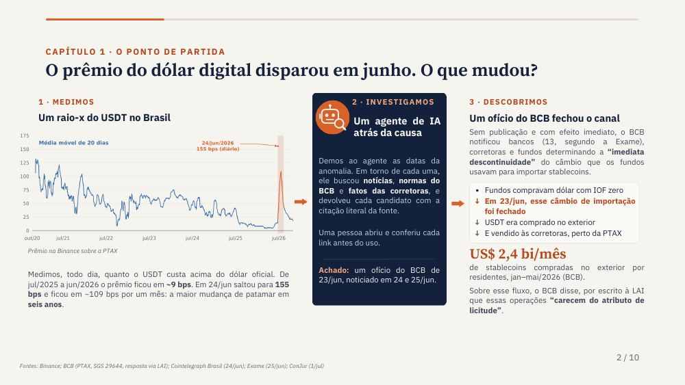
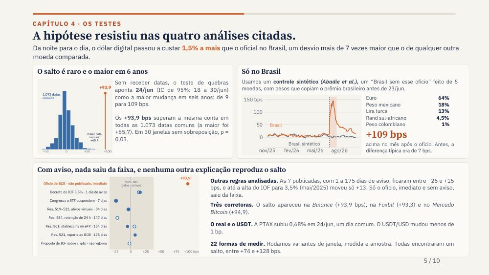
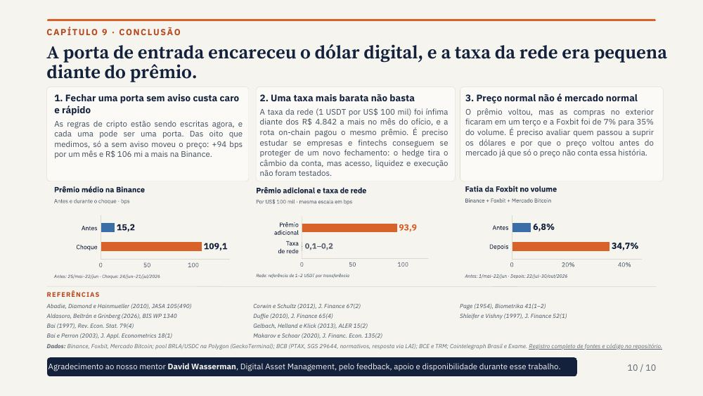

# Quanto custa fechar uma porta?

**Out of Sample · 7º Datathon de Moedas Digitais FGV EESP · 2026**

Um estudo sobre stablecoins, canais de arbitragem e o preço do dólar digital no Brasil. A apresentação entregue pela equipe é o PDF de **10 slides**: [abrir o deck final](deck/out-of-sample_deck.pdf).

## Pergunta e medida

Quanto um canal de arbitragem fechado encarece o dólar digital, por quanto tempo e para quem? Medimos o prêmio do USDT comprado em reais sobre a PTAX, ajustado pelo preço do próprio USDT em dólares. Um ponto-base (bp) equivale a 0,01%.

O estudo se concentra no ofício do Banco Central de 23 de junho de 2026, que determinou a descontinuidade imediata da operação de câmbio usada por fundos para importar ativos virtuais. A associação temporal e os testes são fortes; **o volume efetivo desse canal e o efeito causal isolado do ofício não foram observados diretamente**.

## Resultados apresentados

| Resultado | Leitura | Evidência |
|---|---|---|
| **+93,9 bps** | Aumento do prêmio médio nos 20 dias úteis após 23/jun, frente aos 20 dias anteriores; o prêmio passou de 15,2 para 109,1 bps. | [F-016](findings/F-016-event-studies-placebos.md) |
| **3 corretoras** | O salto foi semelhante na Binance (+93,9), Foxbit (+93,3) e Mercado Bitcoin (+94,9 bps). | [F-009](findings/F-009-jump-not-venue-fx-usdt.md) |
| **R$ 106,1 milhões** | Estimativa do prêmio adicional pago por compradores na Binance nas quatro semanas seguintes; trata-se de uma transferência para vendedores, não de perda de bem-estar medida. | [F-025](findings/F-025-money-moved.md) |
| **Sem efeito persistente demonstrado** | O prêmio caiu a partir de 22/jul; o nível restante não se distingue de variações históricas comuns (placebo p = 0,24). | [F-022](findings/F-022-robustness-battery.md) |

O teste com 1.073 datas comuns não encontrou salto tão grande; 22 variantes da medida encontraram aumentos de +73,7 a +128,3 bps. Essas comparações descrevem a raridade do episódio e a robustez do resultado, mas não eliminam todos os choques concomitantes.

O deck também apresenta a rota Pix → BRLA → USDC (+111 bps no mesmo recorte), a queda de 78% das compras de stablecoins no exterior em julho e a mudança da participação da Foxbit no volume das três corretoras observadas. **Essas extensões têm graus diferentes de revisão**: BRLA e participação da Foxbit continuam exploratórias, com limites de mercado, liquidez e revisão independente registrados em [F-037](findings/F-037-brla-route.md) e [F-036](findings/F-036-recovery-composition.md); a queda das compras está em [F-024](findings/F-024-stablecoin-imports.md). Os perfis de compradores e a regra de espera são ilustrações retrospectivas, não recomendações de negociação ([F-055](findings/F-055-users-and-timing.md)).

## O que a entrega propõe

Uma régua pública para acompanhar o prêmio na janela da PTAX, detectar mudanças com dados disponíveis até cada dia, comparar cada movimento com datas comuns, converter o custo adicional em reais e registrar previsões antes da vigência de novas regras. O primeiro alarme identificou o salto em 24/jun; as previsões posteriores e seus prazos estão no slide 9 e em [P3-20](tasks/P3-20-live-predictions.md).

## Navegação e reprodução

- [Deck final e histórico das versões](deck/README.md) · [Guia complementar da banca](docs/guia-da-banca.md) · [Estado final da documentação](docs/estado-final.md) · [Registro de fontes](docs/sources.md)
- [Pergunta, desenho e plano original](docs/02-dolar-cripto.md) · [Resultados e comandos por achado](findings/) · [Tarefas e revisões](tasks/)
- [Código de análise](scripts/) · [Dados, cobertura e instruções para reconstrução](data/README.md) · [Dependências](requirements.txt)

Os arquivos brutos e processados ficam fora do Git; o [manifesto de dados](data/README.md) documenta fontes, cobertura, checksums e scripts de download. Para reproduzir um número, consulte o comando no respectivo arquivo em `findings/` e execute-o após reconstruir os dados. A apresentação é um recorte dos resultados, e os estudos não incluídos na entrega permanecem identificados como históricos, exploratórios ou descartados em [estado final](docs/estado-final.md).

**Equipe:** Renzo, Nattan, Jonathan e Felipe. O projeto foi desenvolvido para o 7º Datathon de Moedas Digitais FGV EESP (2026).
