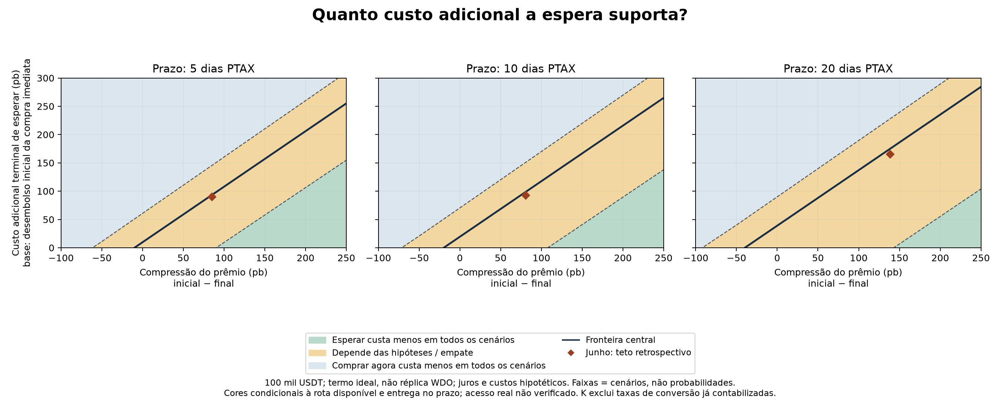

# Waiting is a conditional cost budget, not a forecast of recovery

## Recommendation

Use the new buyer frontier to connect the measured premium to an institutional decision. First establish access and timely settlement. Then compare buying now with waiting. The extension shows the additional cost waiting can absorb before it becomes more expensive than buying now.

The result is deliberately conditional: the June central calculation favors waiting, but the conclusion changes across the specified funding, yield and execution assumptions. That is useful information about what a treasurer needs to verify. It does not establish that waiting is generally best.



## What changed from P3-31

P3-31 already provided seller thresholds, FX sensitivity and a retrospective buyer comparison. This extension adds independently specified deposit and forward rates, an explicit additional-cost budget, a finite stress envelope, and a delivery/access gate for both alternatives. It preserves the original June estimates and corrects F-039's remaining pure-premium and universal-unpredictability language.

The instrument is an ideal, maturity-matched, cash-settled forward. It is not a historical WDO replication. B3's WDO specifications have USD10,000 contract increments and monthly expirations, so a real implementation requires notional and maturity matching plus margin/execution treatment. [B3 specifications](https://www.b3.com.br/en_us/products-and-services/trading/exchange-rates/mini-u-s-dollar-futures.htm)

The forward is not priced from the institution's achievable deposit rate. Those two inputs now vary independently. Actual funding constraints can prevent textbook interest-parity trades from being costless; the present exercise models those differences as scenarios rather than assuming exact accessible parity. [BIS analysis](https://www.bis.org/publications/qr-201609/covered-interest-parity-lost-understanding-cross-currency-basis)

## Comparison and units

The obligation is Q = 100,000 USDT on deadline T. Prices decompose as P = X U (1+p), where X is BRL/USD, U is USD/USDT and p is the local premium as a fraction. Fees are proportional c and fixed BRL f. All costs are compared in terminal reais.

Let A_d be the achievable BRL deposit accumulation, A_h an assumed USDT-unit holding accumulation, and F the independent forward quote. Then:

```text
C0 = (Q / A_h) P0 (1 + c_now) + f_now
B_now = C0 A_d
N = Q U0 (1 + p0) (1 + c_now)       # fixed USD hedge notional, follows P3-31
B_wait = Q P_T (1 + c_wait) + f_wait - N (X_T - F) + K
K_max = B_now - [Q P_T (1 + c_wait) + f_wait - N (X_T - F)]
K_max_bps = 10,000 K_max / C0
```

Waiting is cheaper if K < K_max, equal at the boundary, and more expensive above it—provided both alternatives can deliver. Negative K_max means waiting already loses before nonnegative additional costs.

For scenarios the forward is F = X0 A_forward_BRL / A_forward_USD. The deposit rate is independent of these forward-pricing rates. A future extension can supply an actual quoted F; this run does not have historical executable forward quotes.

K includes only additional waiting costs not already counted: hedge execution, margin funding, residual operational charges or other terminal-value costs. Do not count conversion fees twice. A deposit shortfall relative to forward pricing is already reflected in A_d; do not add the same shortfall to K. Upfront charges must be accumulated to T before comparing to this budget.

USDT holding yield is hypothetical and denominated in USDT units. A USD investment is not automatically equivalent: acquiring USDT again at T would introduce another conversion. No accessible yielding product is asserted.

## Reading the figure

Horizontal position is premium compression: initial premium minus terminal premium. Negative values mean the premium rises further. Vertical position is additional terminal waiting costs, in bps of initial buy-now outlay. The solid line is the central break-even boundary with FX and USDT/USD fixed. Green/blue indicate the same cost ranking across every stress combination; amber means the answer depends on the assumptions or lies at equality.

The 216 combinations cross achievable deposit returns of 0/5/10%, USDT holding yield of 0/4%, terminal USDT/USD factors .995/1/1.005, FX factors .98/1/1.02, waiting conversion fees 10/30 bps and fixed waiting fees R$0/100. Forward-pricing rates stay 10% BRL and 5% USD. Annual rates are effective; horizons use h/252. These ranges were declared as stress assumptions before calculation; they are not calibrated probability bounds.

The June diamonds show retrospective cost ceilings using actual indicative FX and USDT/USD at each horizon. They are not observed additional costs, trade entries or recommendations, and need not sit on the fixed-FX central line.

## Results and implication

| PTAX days after 25 June | Deadline | Central retrospective ceiling | R$ ceiling | Stress ceiling range at observed compression |
|---|---|---:|---:|---:|
| 5 | 2 July | 90.05 bps | 4,758 | −5.07 to +145.56 bps |
| 10 | 9 July | 92.89 bps | 4,908 | −26.62 to +150.65 bps |
| 20 | 23 July | 165.51 bps | 8,745 | −4.51 to +227.89 bps |

All three observed compression values have a stress range spanning zero. Even before additional K costs, the ranking is therefore assumption-sensitive across this envelope. This does not prove real institutions faced these exact ranges; it identifies the assumptions that must be checked before converting the retrospective gain into advice.

The ceilings precede P3-31's 0.22-bp notional hedge fee. That fee consumes K, rather than being embedded and then charged twice. Bps denominators differ: this chart uses initial outlay; the prior buyer comparison uses terminal accumulated buy-now cost. Reais totals and a zero-fee equivalence test reconcile the frameworks.

## Availability comes before price

The code checks both buy-now and wait access states: true, false or unknown. Unknown gives no actionable cost ranking. It does not mean a regulator has prohibited the route. Both alternatives must deliver Q on time. Buying at T with any positive settlement lag is late; buying earlier would require an earlier price and forward maturity and is not silently substituted.

The current illustration assumes same-day settlement on observed PTAX dates; actual bank/exchange calendars, cutoffs, taxes and depth are unavailable. The access-card work supplies a way to document those conditions, but it has not established this historical route's availability. The ledger is evidence of token accounting, not evidence of completed fiat delivery.

## Execution and checks

Run `python scripts/p3_38_buyer_frontier.py --test-only`, then `python scripts/p3_38_buyer_frontier.py`. On this Windows machine the executable is `C:/Users/Felipe/AppData/Local/Programs/Python/Python314/python.exe`.

Ten checks cover hand-computed arithmetic, zero horizon, independently changing deposit rates, fixed costs, holding yield, premium direction, residual FX exposure, missing/invalid prices, both alternatives' access and settlement, equality, and equivalence with the prior default before its hedge fee. Tests do not establish actual institutional execution. The exported figure was visually inspected for labels, marks and legend overlap.

Inspect the P3-38 tables for full scenario definitions, boundaries, conditional classifications, June ceilings and delivery states; input SHA-256 is in `P3-38_audit.json`. Source measurements remain frozen P1-02 data; no download or new price fit was performed. Source links above were opened during the preceding plan review on 7 November and are registered under P3-38 in `docs/sources.md`.

## Suggested Portuguese conclusion

> Uma transferência barata não garante conversão barata e pontual. No cenário central de junho, esperar ofereceu margem para absorver custos adicionais, mas essa vantagem mudou de sinal quando variamos financiamento, rendimento e custos. A decisão exige verificar três coisas: se a rota entrega no prazo, quanto custa financiar a espera e quanto o prêmio precisa cair para compensá-la. O modelo de duração testado não fornece uma previsão robusta que substitua essas verificações.

For the ten-slide deck, replace the previous retrospective treasury chart if the owner adopts this exhibit; keep the algebra and full stress list in the annex. Do not add an eleventh slide or present this accounting boundary as a new causal finding. Independent teammate reproduction remains pending.
