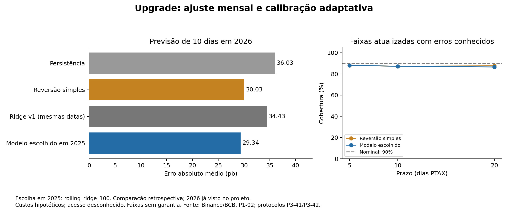

# Compression prototype: monthly adaptation and stress-aware decisions

> **Estado na entrega (8 nov 2026): EXPLORATÓRIO / NÃO USADO NO PDF — atualização do protótipo, sem adoção na entrega.** Veja [estado final](estado-final.md).

The upgrade improves the original ridge model without replacing its evidence record. It adds monthly retraining, a nonlinear challenger, adaptive forecast bands and joint forecast/funding stress cards. Details and limitations are in [F-051](../findings/F-051-compression-upgrade.md); v 1 remains in [F-050](../findings/F-050-premium-compression.md).

The configuration chosen on 2025 is rolling linear ridge with penalty 100. Its 10-day 2026 daily error falls from 34.43 to 29.34 bps, versus 30.03 for simple mean reversion. On the 18 nonoverlapping cases it scores 21.74 versus mean reversion 21.33. Adaptation helps relative to the original ridge, while a reliable advantage over the simpler rule remains unproven. The nonlinear challenger does not clearly improve this comparison.



## How to use and inspect it

```text
python scripts/p3_42_compression_upgrade.py --test-only
python scripts/p3_42_compression_upgrade.py
```

On this machine use the Python executable documented in `docs/premium-compression.md`; no new package is required. Monthly fits use only already-matured targets, and every historical residual used for a band came from an earlier issued forecast. Future-outcome perturbation tests cover both paths.

- `results/tables/P3-42_metrics.csv`: every candidate, baseline, horizon and evaluation sample, with errors, coverage and central scenario savings.
- `P3-42_selection.csv`: all 2025 selection scores; `P3-42_v1_comparison.csv` and `P3-42_baseline_gaps.csv`: matched comparisons.
- `P3-42_predictions.csv` and `P3-42_fit_trace.csv`: signal, execution, label-maturity and calibration records.
- `P3-42_decision_cards.csv`: fixedJune replay and archive-as-of 30 October cards. Central and stress labels are separate; actual access is always unknown.

The stress cards ask whether the whole forecast band supports waiting across the existing 216 funding/execution scenarios. June's central waiting signals become insufficient evidence across those assumptions. That is a practical upgrade: a favorable forecast alone does not settle the institutional decision.

Conditional historical savings use central assumptions and an abstain-to-buy fallback. The nonoverlapping 10-day result depends on only one waiting case. It is not evidence of an implementable profitable strategy. All results remain exploratory because 2026 was already inspected before this upgrade. Independent revision should focus on information timing, matched comparisons, sparse decisions and the distinction between central and stress labels.
