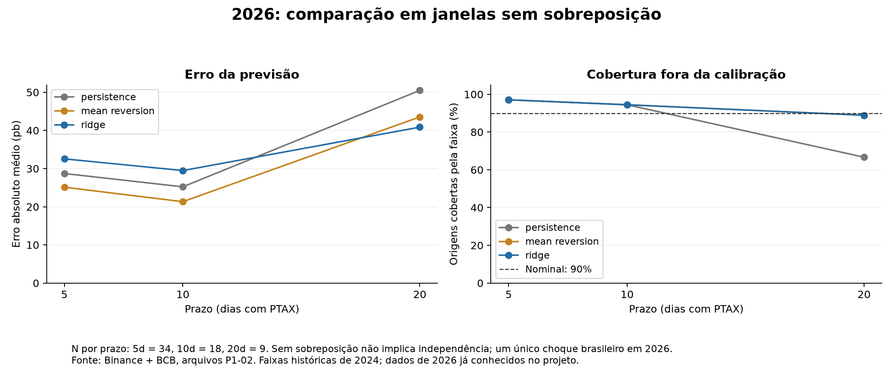
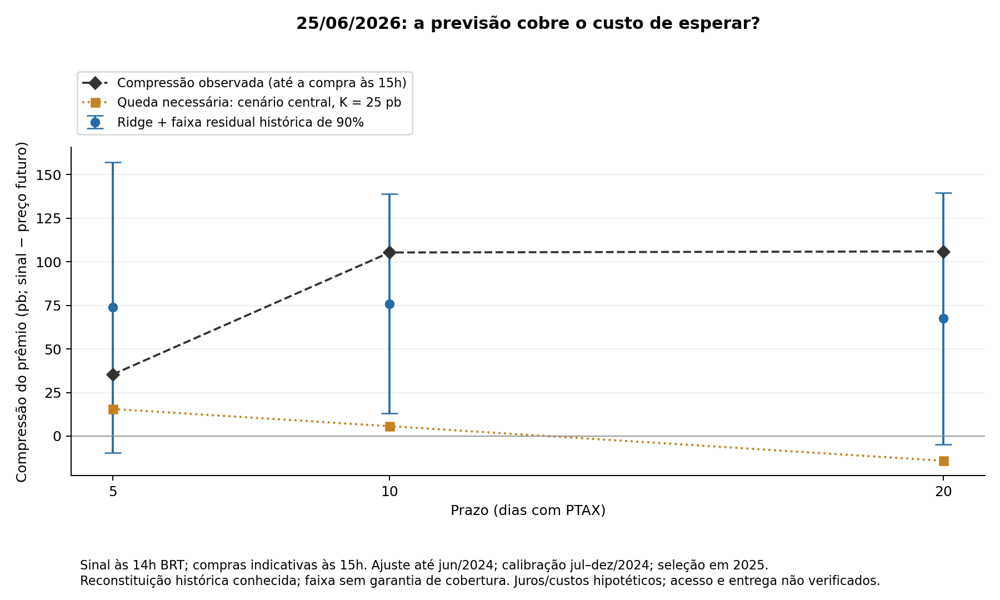

# From a premium forecast to a conditional waiting decision

> **Estado na entrega (8 nov 2026): EXPLORATÓRIO / NÃO USADO NO PDF — protótipo sem ganho demonstrado na decisão principal.** Veja [estado final](estado-final.md).

The first version is implemented in `scripts/p3_41_compression.py`. It asks whether partial compression before a payment deadline can cover waiting costs. It reuses the buyer cost function from P3-39 (artifact prefix P3-38), and keeps the measured June effect and the duration study unchanged.

**Current result:** ridge does not beat simple mean reversion on the primary 10-day horizon. Across 196 daily 2026 origins, MAE is 34.43 bps for ridge, 30.03 for mean reversion and 36.03 for persistence. On 18 fixed nonoverlapping origins, the corresponding errors are 29.49, 21.33 and 25.22 bps. The conditional waiting rule does not establish economic improvement. Full evidence, attempt disclosure and limitations: [F-050](../findings/F-050-premium-compression.md).

## What the prototype does
1. At 14:00 Brasília, check that same-day PTAX has been published and required historical observations exist.
2. Forecast compression at 5/10/20 PTAX-day horizons using persistence, fixed mean reversion and ridge with lagged premiums, volatility and volume. Model selection uses 2025; parameters are fit only through June 2024.
3. Attach 90% empirical historical residual bands calibrated on July–December 2024. Report measured coverage rather than promise it.
4. Convert forecast bounds into a cost budget under explicit central funding assumptions. Compare with additional terminal waiting costs of 0/25/50 bps.
5. Apply access and delivery gates. Unknown access means insufficient evidence. For scenario evaluation only, abstentions default to buy now.
6. Replay buy-now and deadline purchases at the 15:00 Brasília hourly open, one hour after the signal, using the actual prices in the accounting comparison. This avoids buying retrospectively at the earlier signal price.

The base obligation is 100,000 USDT; the ideal forward is not a replicated WDO strategy. Forward rates, deposit rates and USDT yields are scenarios; this first forecast experiment does not apply the full P3-39 stress envelope. Indicative PTAX and first-trade prices do not establish executable access, hedge pricing or delivery.

## Inspect the output


The June replay illustrates the interface; it is not evidence of general predictive performance. On 25 June the indicative premium dropped almost 50 bps between signal and execution. Waiting five days then loses under the central cost assumptions, despite positive compression measured from the earlier signal. At ten and twenty days the ridge band supports a conditional wait, but access remains unknown.



## Run and reuse
From the repository root, using an installed Python with NumPy, pandas and matplotlib:

```text
python scripts/p3_41_compression.py --test-only
python scripts/p3_41_compression.py
```

On this Windows machine the interpreter used was `C:/Users/Felipe/AppData/Local/Programs/Python/Python314/python.exe`; the system `python` alias and `py` launcher did not work. Package versions are recorded in the audit, rather than claiming the repository's original pinned environment was used.

`results/tables/P3-41_predictions.csv` records each signal, execution time, forecast band, cost boundary, conditional label, eligibility and realized scenario outcome. `P3-41_june_replay.csv` is the fixed exhibit; `P3-41_metrics.csv` and `P3-41_policies.csv` retain all comparisons. `P3-41_input_panel.csv` makes the feature/clock audit inspectable. Split boundaries, coefficients, calibration and provenance have separate tables.

`P3-41_latest.csv` is an **archive-as-of 30 October 2026** forecast, not a live market recommendation. It does not need a future target to produce a forecast. Horizons are counts of future PTAX days; no unverified payment calendar is supplied.

For integration, `assess(...)` accepts a compression point forecast, residual radius, horizon, signal premium, FX/USDTUSD, additional costs and explicit access/settlement inputs. It returns both the conditional cost label and the gated actionable label. Passing `None` for access preserves unknown evidence; passing `True` is an explicit scenario assumption, not a certification supplied by the model.

## Next step
Have a teammate reproduce F-050 before deck use. Retain simple mean reversion as the main forecasting benchmark. Any subsequent rolling-fit, boosted-tree, transformer or international experiment needs a separately recorded protocol and attempt log; do not choose one by repeatedly inspecting the current 2026 scores. The present result is useful for the operational distinction between a known historical gain and a forecast that supports a decision. It does not justify a claim that machine learning improved acquisition timing.
