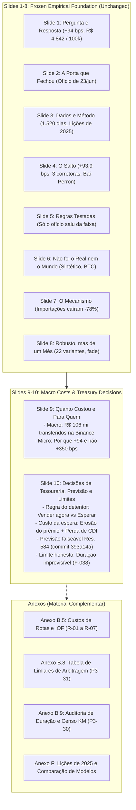

# From Retrospective Shock Analysis to Institutional Treasury Decisions: Comprehensive Assessment of Shock Duration and Holder Decisions

**Author / Working Role:** Codex (Research Engineer and Critical Reviewer for Felipe)  
**Date:** 6 November 2026, Brasília time  
**Context:** 7º Datathon de Moedas Digitais FGV EESP (Team Out of Sample)  
**Task Reference:** `tasks/P3-33-pivot-assessment.md` (synthesizing `P3-30`, `P3-31`, `P3-32`)  
**Input Documents:** `docs/shock-duration-and-holder-decisions-research-brief.md`, `findings/F-038-shock-duration-feasibility.md`, `findings/F-039-holder-decisions.md`, `docs/shock-duration-holder-review.md`  
**Status:** Completed deliverable; submission-first synthesis; local repository document.

---

## Table of Contents

1. [Executive Recommendation and the Mentor-Driven Objective Change](#1-executive-recommendation-and-the-mentor-driven-objective-change)
2. [Evidence Inventory and Claim Hierarchy](#2-evidence-inventory-and-claim-hierarchy)
3. [Systematic Assessment of Directions in the Original Brief](#3-systematic-assessment-of-directions-in-the-original-brief)
4. [Institutional Holder Decision Framework (`P3-31` / `F-039`)](#4-institutional-holder-decision-framework-p3-31--f-039)
5. [Shock Duration Prediction and Feasibility Audit (`P3-30` / `F-038`)](#5-shock-duration-prediction-and-feasibility-audit-p3-30--f-038)
6. [Independent Review and Verification Record (`P3-32` / `docs/shock-duration-holder-review.md`)](#6-independent-review-and-verification-record-p3-32--docsshock-duration-holder-reviewmd)
7. [Two-Day Execution Record, Reproducible Commands, and Open Blockers](#7-two-day-execution-record-reproducible-commands-and-open-blockers)
8. [Portuguese Conclusion Alternatives for Slide 10 (`P5-08`)](#8-portuguese-conclusion-alternatives-for-slide-10-p5-08)
9. [Proposed 10-Slide Deck Narrative and Annex Allocation](#9-proposed-10-slide-deck-narrative-and-annex-allocation)

---

## 1. Executive Recommendation and the Mentor-Driven Objective Change

### 1.1 The Mentor Challenge: Bridging Econometrics and Action

Through phases P1 to P4 of the Datathon, the team successfully established the core econometric facts surrounding the 23 June 2026 Banco Central do Brasil (BCB) supervisory notice (*ofício*):
- An acute, unprecedented spike of **+93.9 bps** ($+73.7$ to $+128.3$ bps across 22 specifications) in the USDT/BRL premium over official PTAX ([`F-016`](file:///c:/Users/Felipe/Desktop/fgv_eesp/7-datathon-fgv-eesp/findings/F-016-event-studies-placebos.md), [`F-022`](file:///c:/Users/Felipe/Desktop/fgv_eesp/7-datathon-fgv-eesp/findings/F-022-robustness-battery.md));
- A blind structural break detected at 24 June 2026 across all three major Brazilian venues ([`F-011`](file:///c:/Users/Felipe/Desktop/fgv_eesp/7-datathon-fgv-eesp/findings/F-011-blind-breaks.md), [`F-009`](file:///c:/Users/Felipe/Desktop/fgv_eesp/7-datathon-fgv-eesp/findings/F-009-jump-not-venue-fx-usdt.md));
- A synthetic control treatment gap of **+109.3 bps** separating Brazil from international comparison currencies ([`F-017`](file:///c:/Users/Felipe/Desktop/fgv_eesp/7-datathon-fgv-eesp/findings/F-017-synthetic-control.md));
- A **$-78\%$ contraction** in resident stablecoin purchases abroad in official balance of payments statistics ([`F-024`](file:///c:/Users/Felipe/Desktop/fgv_eesp/7-datathon-fgv-eesp/findings/F-024-stablecoin-imports.md)); and
- An aggregate private wealth transfer of **R\$ 106.1 million** on Binance alone (**R\$ 145.3 million** across three venues) paid by crypto-dollar buyers over four weeks ([`F-025`](file:///c:/Users/Felipe/Desktop/fgv_eesp/7-datathon-fgv-eesp/findings/F-025-money-moved.md)).

Despite these rigorous empirical results, the mentor session on 4 November 2026 with David Wasserman (FGV / ex-QR Asset) crystallized a vital strategic vulnerability: **explaining a historical market breakdown does not by itself answer what an affected market participant should do when the next shock occurs.** If the presentation stops at describing an administrative *canetada* and its temporary price distortion, an academic jury can legitimately ask: *"So what? How does this economic finding guide corporate treasurers, fintech operators, or portfolio managers holding digital dollars in Brazil?"*

Felipe initiated an exploratory research pivot ([`docs/shock-duration-and-holder-decisions-research-brief.md`](file:///c:/Users/Felipe/Desktop/fgv_eesp/7-datathon-fgv-eesp/docs/shock-duration-and-holder-decisions-research-brief.md)) to explore whether our research could produce an operational decision engine for digital-dollar holders.

### 1.2 The Economic Intuition: The Double Cost of Waiting

A conventional, unmodeled market intuition suggests that when a market experiences a sudden price distortion (such as an elevated premium), an asset holder should "wait for conditions to normalize" before transacting. In the context of an institutional USDT holder with a future Brazilian Real (BRL) obligation (such as tax liabilities, supplier invoices, payroll, or contractual debt), **this intuition is financially destructive.**

Waiting for normalization imposes two compounding financial losses:
1. **Loss of the Elevated Liquidation Premium (Premium Erosion):** An institution holding USDT during a premium spike possesses an asset trading at a substantial local markup over the official foreign exchange rate (PTAX). If the holder waits for the market to normalize, that elevated premium compresses back toward the baseline noise floor (historically 2 to 10 bps; [`F-007`](file:///c:/Users/Felipe/Desktop/fgv_eesp/7-datathon-fgv-eesp/findings/F-007-noise-floor.md)). The holder forfeits the opportunity to monetize this temporary premium into BRL.
2. **Forgone Local Risk-Free Interest (Negative BRL Carry):** Idle USDT balances in an exchange account or cold wallet generate $0\%$ yield in BRL. Conversely, Brazil maintains high real and nominal interest rates (CDI / Selic historically ranging from $10\%$ to $15\%$ effective annual net return). Converting USDT to BRL today allows the institution to deploy the net proceeds into sovereign or bank liquidity instruments (such as LFTs, bank deposit certificates / CDBs, or overnight repo) until the liability maturity date. Every business day spent waiting is a day of forgone risk-free BRL carry.

To justify waiting, the gross USDT/BRL exchange rate must appreciate rapidly enough to outpace **both** the erosion of the local premium and the positive BRL risk-free interest rate. 

### 1.3 The Guaranteed Practical Deliverable vs. Honest Bounded Modeling

To resolve the mentor's challenge within the remaining Datathon timeline, our pivot established two clear engineering workstreams:

1. **The Guaranteed Practical Deliverable (`P3-31` / [`F-039`](file:///c:/Users/Felipe/Desktop/fgv_eesp/7-datathon-fgv-eesp/findings/F-039-holder-decisions.md)):** An exact, closed-form institutional decision framework. It models the terminal net BRL cash flows of immediate liquidation versus delayed conversion across explicit investment horizons, hurdle rates, and transaction fee schedules. It provides actionable break-even conditions that do not depend on statistical forecasting assumptions.
2. **The Bounded Duration Feasibility Audit (`P3-30` / [`F-038`](file:///c:/Users/Felipe/Desktop/fgv_eesp/7-datathon-fgv-eesp/findings/F-038-shock-duration-feasibility.md)):** A strict, pre-registered econometric protocol testing whether the recovery duration of local premium spikes can be predicted out-of-sample. Rather than manufacturing a false predictive claim, our evaluation demonstrated that the 2026 out-of-sample test period contains **only one new Brazilian episode** under locked rules, which remained unrecovered at the data cutoff. Because this fails pre-registered feasibility guardrails, **no duration model was fitted, and no predictive accuracy is claimed.** Duration is treated honestly as an exogenous scenario parameter ($5, 10, 20$ business days), directly protecting the team against jury skepticism and adhering to the core team principle: *"Disclose everything you tried; negative or null results are reported honestly."*

---

## 2. Evidence Inventory and Claim Hierarchy

To ensure strict scientific transparency, every claim, metric, and parameter utilized in this assessment is explicitly cataloged across four operational tiers.

```
+----------------------------------------------------------------------------------------------------+
|                                    RESEARCH EVIDENCE HIERARCHY                                      |
+----------------------------------------------------------------------------------------------------+
|  TIER 1: FROZEN FINDINGS (F-001 to F-033)                                                          |
|  - Tagged `results-frozen` on 4 Nov 2026. Immutable empirical baseline.                             |
|  - F-001/F-002: Real premium & +93.9 bps jump on 24 Jun 2026.                                      |
|  - F-007/F-009: 2-10 bps noise floor; identical jump across Binance, Foxbit, Mercado Bitcoin.       |
|  - F-011/F-016: Blind Bai-Perron break; p ≈ 0.001 vs 1,073 clean placebos.                         |
|  - F-015/F-025: R$ 4,842 / US$ 100k acute cost; R$ 106.1 mn transfer on Binance.                   |
|  - F-022/F-024: Post-22 Jul fade indistinguishable from drift (p=0.24); imports fell -78%.         |
|  - F-026/F-027: Only confidential notice moved premium; Res. 584 prediction committed.             |
+----------------------------------------------------------------------------------------------------+
                                                 |
                                                 v
+----------------------------------------------------------------------------------------------------+
|  TIER 2: EXPLORATORY FINDINGS (F-034 to F-037)                                                      |
|  - Post-freeze investigations subject to explicit caveats.                                         |
|  - F-034/F-037: BRLA on-chain Pix->BRLA->USDC route paid +111 bps over PTAX.                       |
|  - F-035: Registered prediction E1 held (+2.1 bps under Res. 574, p=0.90).                         |
|  - F-036: Foxbit volume share surged from 6.8% to 34.7% during recovery and persisted.             |
+----------------------------------------------------------------------------------------------------+
                                                 |
                                                 v
+----------------------------------------------------------------------------------------------------+
|  TIER 3: NEW DECISION & FEASIBILITY CALCULATIONS (F-038 & F-039)                                   |
|  - P3-30 / F-038: Episode census & feasibility audit. Only 1 test episode in 2026 (unrecovered).   |
|    Predictive gate fails; duration modeled via scenario horizons (5, 10, 20 days).                  |
|  - P3-31 / F-039: Exact institutional holder equations, required appreciation thresholds          |
|    (18.9, 37.9, 75.9 bps at 10% rate), and retrospective June 2026 comparison.                     |
+----------------------------------------------------------------------------------------------------+
                                                 |
                                                 v
+----------------------------------------------------------------------------------------------------+
|  TIER 4: SCENARIO & COST ASSUMPTIONS (R-01 to R-07, CDI / Selic Scenarios)                         |
|  - R-01: BCB EE 48/2019 commercial bank corporate FX spread: 20 bps baseline.                     |
|  - R-01b: Banco do Brasil PJ SWIFT international transfer tariffs.                                 |
|  - R-02: Statutory IOF rates (Decreto 6.306/2007: 0% funds art. 15-B III; 1.1%; 3.5%).            |
|  - R-05/R-06: Foxbit & Mercado Bitcoin maker/taker execution schedules.                             |
|  - R-07: 1-day CIP carry / box-spread implied financing costs (~2.5 bps/day).                      |
|  - Rate Scenarios: 0%, 5%, 10%, 15%, 20% effective annual net BRL returns (hypothetical carry).   |
+----------------------------------------------------------------------------------------------------+
```

### Table 2.1: Master Evidence Inventory

| Category | Identifier | Description / Exact Value | Status in Repository | Function in Assessment |
|---|---|---|---|---|
| **Frozen Core** | [`F-001`](file:///c:/Users/Felipe/Desktop/fgv_eesp/7-datathon-fgv-eesp/findings/F-001-premium-above-noise.md) | USDT/BRL premium is real (0.2–1.0%), exceeding noise | Frozen (`results-frozen`) | Baseline price phenomenon |
| **Frozen Core** | [`F-007`](file:///c:/Users/Felipe/Desktop/fgv_eesp/7-datathon-fgv-eesp/findings/F-007-noise-floor.md) | Bid-ask trading friction floor is 2–10 bps | Frozen (`results-frozen`) | Floor for economic significance |
| **Frozen Core** | [`F-009`](file:///c:/Users/Felipe/Desktop/fgv_eesp/7-datathon-fgv-eesp/findings/F-009-jump-not-venue-fx-usdt.md) | Jump identical across Binance, Foxbit, MB; not USD/USDT | Frozen (`results-frozen`) | Cross-venue market validity |
| **Frozen Core** | [`F-011`](file:///c:/Users/Felipe/Desktop/fgv_eesp/7-datathon-fgv-eesp/findings/F-011-blind-breaks.md) | Blind Bai-Perron break on 24 Jun 2026 (+100 bps) | Frozen (`results-frozen`) | Unsupervised timing verification |
| **Frozen Core** | [`F-015`](file:///c:/Users/Felipe/Desktop/fgv_eesp/7-datathon-fgv-eesp/findings/F-015-route-costs.md) | Acute cost: R\$ 4,842 per US\$ 100k (+93.9 bps at daily PTAX) | Frozen (`results-frozen`) | Dollar-cost unit anchor |
| **Frozen Core** | [`F-016`](file:///c:/Users/Felipe/Desktop/fgv_eesp/7-datathon-fgv-eesp/findings/F-016-event-studies-placebos.md) | 23 Jun notice moved premium (+93.9 bps, $p \approx 0.001$) | Frozen (`results-frozen`) | Causal event study benchmark |
| **Frozen Core** | [`F-017`](file:///c:/Users/Felipe/Desktop/fgv_eesp/7-datathon-fgv-eesp/findings/F-017-synthetic-control.md) | Synthetic control treatment gap: +109.3 bps (rank 1/6) | Frozen (`results-frozen`) | International counterfactual |
| **Frozen Core** | [`F-022`](file:///c:/Users/Felipe/Desktop/fgv_eesp/7-datathon-fgv-eesp/findings/F-022-robustness-battery.md) | Post-22 Jul level (+11 to +19 bps) has placebo $p = 0.24$ | Frozen (`results-frozen`) | Honest limitation of spike duration |
| **Frozen Core** | [`F-025`](file:///c:/Users/Felipe/Desktop/fgv_eesp/7-datathon-fgv-eesp/findings/F-025-money-moved.md) | Buyers paid R\$ 106.1 mn extra on Binance (R\$ 145.3 mn total) | Frozen (`results-frozen`) | Macroeconomic transfer sizing |
| **Frozen Core** | [`F-026`](file:///c:/Users/Felipe/Desktop/fgv_eesp/7-datathon-fgv-eesp/findings/F-026-which-rules-matter.md) | Only confidential notice moved premium outside $[-35, +38]$ bps | Frozen (`results-frozen`) | Regulatory notice format finding |
| **Exploratory** | [`F-035`](file:///c:/Users/Felipe/Desktop/fgv_eesp/7-datathon-fgv-eesp/findings/F-035-e1-res574-readout.md) | Registered prediction E1 held (+2.1 bps move, $p = 0.90$) | Exploratory | Pre-registered policy validation |
| **Exploratory** | [`F-036`](file:///c:/Users/Felipe/Desktop/fgv_eesp/7-datathon-fgv-eesp/findings/F-036-recovery-composition.md) | Foxbit market share rose from 6.8% to 34.7% post-shock | Exploratory | Market microstructure adaptation |
| **Exploratory** | [`F-037`](file:///c:/Users/Felipe/Desktop/fgv_eesp/7-datathon-fgv-eesp/findings/F-037-brla-route.md) | Polygon Pix $\to$ BRLA $\to$ USDC route rose +111 bps | Exploratory | On-chain rail transmission |
| **New Audit** | [`F-038`](file:///c:/Users/Felipe/Desktop/fgv_eesp/7-datathon-fgv-eesp/findings/F-038-shock-duration-feasibility.md) | 1 eligible 2026 episode; duration model unfeasible | New Calculation (`P3-30`) | Empirical boundary on duration |
| **New Engine** | [`F-039`](file:///c:/Users/Felipe/Desktop/fgv_eesp/7-datathon-fgv-eesp/findings/F-039-holder-decisions.md) | Required appreciation thresholds & retrospective comparison | New Calculation (`P3-31`) | Core practical deliverable |
| **Parameters** | `R-01`..`R-07` | Corporate FX spreads, exchange fee schedules, IOF taxes | Scenarios / Sources | Empirical friction bounds |

---

## 3. Systematic Assessment of Directions in the Original Brief

In [`docs/shock-duration-and-holder-decisions-research-brief.md`](file:///c:/Users/Felipe/Desktop/fgv_eesp/7-datathon-fgv-eesp/docs/shock-duration-and-holder-decisions-research-brief.md), Felipe documented six exploratory research ideas. Below is a rigorous technical evaluation of all six ideas, detailing data constraints, confounding mechanisms, and the rationale for selecting **Direction 3** and a bounded **Direction 5** while documenting the remaining four outside execution.

### Table 3.1: Evaluation of the Six Candidate Research Directions

```
+----------------------------------------------------------------------------------------------------+
| Direction / Ambition         | Feasibility & Data Constraints     | Confounding & Econometric Risk  | Disposition in Project       |
+------------------------------+------------------------------------+---------------------------------+------------------------------+
| 1. Fair "Brazil Risk"        | High data availability (PTAX, CDS, | Confounded by local crypto      | Documented as future work.   |
|    Benchmark Premium         | DI swaps), but no observable clean | liquidity constraints & capital | Not selected: arbitrary      |
|                              | risk-neutral crypto shadow price.  | controls. Average != "fair".    | rolling mean lacks theory.   |
+------------------------------+------------------------------------+---------------------------------+------------------------------+
| 2. Canetada Transmission     | High data availability. Hourly     | Triangulation enforces price    | Integrated into frozen core  |
|    Across Markets & Venues   | order books, on-chain DEX pools,   | lockstep; cannot isolate        | (F-009, F-018, F-037).       |
|                              | multi-venue feeds verified.        | asset-specific regulatory risk. | Complete; no new math needed.|
+------------------------------+------------------------------------+---------------------------------+------------------------------+
| 3. Institutional Holder      | Fully tractable. Requires market   | Past purchase prices are sunk   | SELECTED AS PRIMARY          |
|    Conversion vs. Waiting    | window quotes, fee schedules, and  | costs; calendar mismatches must | DELIVERABLE (P3-31 / F-039). |
|    Decision Framework        | explicit BRL rate scenarios.       | be audited transparently.       | Closed-form financial engine.|
+------------------------------+------------------------------------+---------------------------------+------------------------------+
| 4. SOFR & On-Chain Yield     | High data availability (Aave,      | F-020 showed 37-54% of DeFi     | Documented outside scope.    |
|    Spreads Optimization      | Compound, SOFR archives), but      | yield is token subsidies.       | Irrelevant for institutional |
|                              | irrelevant for BRL obligations.    | BRL carry dominates USD yield.  | BRL liability funding.       |
+------------------------------+------------------------------------+---------------------------------+------------------------------+
| 5. Statistical Modeling of   | Pre-registered protocol feasible,  | Extreme sample scarcity in      | SELECTED AS BOUNDED AUDIT    |
|    Shock Duration            | but only 1 BRL episode in 2026     | out-of-sample test split.       | (P3-30 / F-038). Honest      |
|                              | test split (censored at 111 days). | Risk of severe overfitting.     | null; duration as scenario.  |
+------------------------------+------------------------------------+---------------------------------+------------------------------+
| 6. Learning from Global      | 11 dollar depeg events cataloged   | Severe category error: issuer   | Excluded from pooling.       |
|    Depegs & On-Chain Shocks  | (F-013, F-019), but pooling with   | insolvency/credit risk != local | Preserved only as qualitative|
|                              | local FX premia is invalid.        | sovereign FX capital friction.  | institutional analogy.       |
+------------------------------+------------------------------------+---------------------------------+------------------------------+
```

### 3.1 Direction 1: Fair "Brazil Risk" Benchmark Premium
- **Concept:** Isolate what portion of the USDT/BRL premium represents an equilibrium compensation for holding crypto assets subject to Brazilian legal, administrative, and tax jurisdiction ("Brazil risk") versus transitory market dislocation.
- **Critical Evaluation:** In traditional asset pricing, a "fair risk premium" is derived from structural models or risk-neutral expectations (e.g., sovereign CDS spreads, covered interest parity deviations). In digital-dollar markets, however, the observed premium is heavily driven by physical limits to arbitrage (banking choke points, IOF tax differentials, exchange withdrawal latency) rather than pure credit risk. Computing a historical rolling average or MAD band (as done in `P3-30`) provides a statistical definition of "abnormality," but labeling any historical level as "economically fair" is theoretically ungrounded. Without a structural model of segmented market equilibrium, this direction risks presenting an arbitrary statistical convention as an economic fundamental. It is retained as a future research question.

### 3.2 Direction 2: Canetada Transmission Across Multiple Markets and Locations
- **Concept:** Track how an unexpected supervisory intervention (*canetada*) propagates across exchanges (Binance, Foxbit, Mercado Bitcoin), asset classes (BTC, ETH), on-chain rails (BRLA on Polygon), and international corridors.
- **Critical Evaluation:** This direction was already thoroughly and successfully executed across P2 and P3:
  - [`F-009`](file:///c:/Users/Felipe/Desktop/fgv_eesp/7-datathon-fgv-eesp/findings/F-009-jump-not-venue-fx-usdt.md) proved transmission across Brazilian exchanges was immediate and identical (+93.9 bps on Binance, +93.3 bps on Foxbit, +94.9 bps on Mercado Bitcoin).
  - [`F-018`](file:///c:/Users/Felipe/Desktop/fgv_eesp/7-datathon-fgv-eesp/findings/F-018-btc-heterogeneity.md) proved that BTC/BRL jumped by an identical +93.8 bps via internal triangular arbitrage within Binance.
  - [`F-037`](file:///c:/Users/Felipe/Desktop/fgv_eesp/7-datathon-fgv-eesp/findings/F-037-brla-route.md) demonstrated that the on-chain Polygon route (Pix $\to$ BRLA $\to$ USDC) absorbed a +111.0 bps premium post-notice.
  - [`F-017`](file:///c:/Users/Felipe/Desktop/fgv_eesp/7-datathon-fgv-eesp/findings/F-017-synthetic-control.md) confirmed that foreign currencies (EUR, TRY, ZAR, MXN, COP) experienced no transmission, isolating the shock to Brazil.
  Because the empirical transmission pattern is already frozen and fully explained, duplicating it as an open question would dilute the deck. It serves as the verified empirical foundation for the holder framework.

### 3.3 Direction 3: Institutional Holder Conversion vs. Waiting Decision
- **Concept:** Formulate an actionable treasury decision rule for an entity holding USDT and facing a future BRL expenditure, comparing the financial outcome of immediate conversion versus delayed conversion.
- **Critical Evaluation:** This is the highest-value, most practical contribution. It directly answers the mentor's demand by converting empirical spread measurements into an actionable corporate treasury calculation. It is mathematically tractable, requires no speculative predictive claims, and directly exposes the severe opportunity costs of Brazilian interest rates. This was selected as the **primary deliverable** (`P3-31` / [`F-039`](file:///c:/Users/Felipe/Desktop/fgv_eesp/7-datathon-fgv-eesp/findings/F-039-holder-decisions.md)).

### 3.4 Direction 4: SOFR and On-Chain Protocol Spreads / Yield Optimization
- **Concept:** Benchmark the holding decision against US dollar yields (SOFR) or decentralized finance (DeFi) lending yields (e.g., Aave/Compound USDT deposits).
- **Critical Evaluation:** While conceptually appealing to crypto-native participants, this direction introduces two major flaws for a Brazilian corporate entity:
  1. *Subsidized Yields:* In the 2025 Datathon, the team proved ([`F-020`](file:///c:/Users/Felipe/Desktop/fgv_eesp/7-datathon-fgv-eesp/findings/F-020-subsidy-share-2025.md)) that between $37.5\%$ and $53.6\%$ of DeFi lending spreads over SOFR were artificial governance token subsidies rather than economic risk premia.
  2. *Currency Mismatch:* An institution funding a **BRL liability** faces an opportunity cost defined by local risk-free rates (CDI/Selic at 10%–15%), not dollar rates (SOFR at 4%–5%). Earning 5% in USDT lending while leaving the BRL obligation unhedged exposes the institution to uncompensated FX volatility and negative carry. Consequently, this direction was set aside in favor of a clean, real-denominated liability comparison.

### 3.5 Direction 5: Statistical Modeling of Shock Duration
- **Concept:** Estimate parametric or non-parametric survival models (Kaplan-Meier, discrete-time logistic hazard, Accelerated Failure Time) to forecast how many days an elevated premium will persist before normalizing.
- **Critical Evaluation:** Bounded and tested in `P3-30`. As detailed in Section 5, the historical data in Brazil yields only **one single episode in 2026** under strict retrospective extraction rules. Fitting an out-of-sample machine learning model on a single observation violates the team's non-negotiable research standards ([`prompt.md`](file:///c:/Users/Felipe/Desktop/fgv_eesp/7-datathon-fgv-eesp/prompt.md) §5). The direction was retained strictly as an **honest feasibility audit** ([`F-038`](file:///c:/Users/Felipe/Desktop/fgv_eesp/7-datathon-fgv-eesp/findings/F-038-shock-duration-feasibility.md)), demonstrating to the jury that the team tested duration prediction rigorously rather than asserting speculative recovery forecasts.

### 3.6 Direction 6: Learning from Global On-Chain and Stablecoin Depeg Shocks
- **Concept:** Pool global stablecoin depeg events (e.g., USDC during the Silicon Valley Bank weekend, Terra/UST collapse, USDT historical micro-depegs) to increase statistical power for duration estimation.
- **Critical Evaluation:** Pooling global stablecoin depegs with local FX premium spikes represents a severe **category error**:
  - *Dollar Depegs (DP-01 to DP-11; [`F-013`](file:///c:/Users/Felipe/Desktop/fgv_eesp/7-datathon-fgv-eesp/findings/F-013-depeg-count-v2.md), [`F-019`](file:///c:/Users/Felipe/Desktop/fgv_eesp/7-datathon-fgv-eesp/findings/F-019-depeg-chapter.md)):* Stablecoin price deviations from \$1.00 USD reflect **insolvency risk, credit impairment, or banking-system reserve loss** of the centralized issuer or algorithmic mechanism. When confidence collapses, recovery depends on external sovereign guarantees (e.g., FDIC guarantee of SVB deposits on Sunday night) or ends in total collapse (UST).
  - *Local FX Premium Shocks (USDT/BRL):* Deviations from official PTAX reflect **domestic capital controls, regulatory enforcement on banking corridors, and balance-of-payments frictions.** The stablecoin itself remains fully solvent and pegged at \$1.00 USD in global markets; it trades at an elevated price in Brazil because domestic fiat cannot easily exit to buy cheaper supply abroad.
  Because the underlying economic mechanisms, governing institutions, and tail risks are fundamentally non-comparable, pooling them into a common survival dataset would introduce severe bias.

---

## 4. Institutional Holder Decision Framework (`P3-31` / `F-039`)

### 4.1 Theoretical Formulation and Equations

Consider an institution holding a quantity $Q$ of idle USDT at time $t$ (the onset or observation of a premium spike), facing a mandatory, non-negotiable BRL payment obligation due at business day $T \ge t$. The planning horizon in business days is $D = T - t$.

#### 1. Price Multiplicative Identity
At any business day $\tau$, the gross spot conversion price of USDT into BRL is identically:
$$P_\tau = X_\tau \cdot U_\tau \cdot \left(1 + \frac{p_\tau}{10{,}000}\right)$$
where:
- $X_\tau$: Official PTAX foreign exchange rate (BRL per USD, ask/venda quote);
- $U_\tau$: Global price of USDT in USD (typically $U_\tau \approx 1.000 \pm 0.001$);
- $p_\tau$: Local market premium over PTAX, denominated in basis points.

#### 2. Net Realized Conversion Proceeds
Converting quantity $Q$ at day $\tau$ incurs a proportional execution friction $c_\tau \in [0, 1)$ (representing the half-spread, taker fee, and banking conversion tariff) and an optional fixed transaction charge $f_\tau \ge 0$ (such as wire transfer or custody settlement fees):
$$N_\tau(Q) = Q \cdot P_\tau \cdot (1 - c_\tau) - f_\tau$$

#### 3. Path 1: Immediate Conversion ("Sell Now")
If the institution converts at time $t$, net BRL proceeds $N_t(Q)$ are immediately deposited into a risk-free BRL cash equivalent (e.g., LFT, overnight CDI repo) earning a net effective annual return $r \ge 0$. Assuming same-day BRL settlement lag ($s_t = 0$), the cash accumulates over $D$ business days on a conventional Brazilian 252-day business-day convention:
$$A_{t,T} = (1 + r)^{\frac{D - s_t}{252}}$$
Terminal BRL cash position at deadline $T$:
$$V_t^{\text{sell}} = N_t(Q) \cdot A_{t,T} = \left[Q \cdot P_t \cdot (1 - c_t) - f_t\right] \cdot (1 + r)^{\frac{D - s_t}{252}}$$

#### 4. Path 2: Delayed Conversion ("Wait and Hold Idle USDT")
If the institution holds idle USDT until the obligation deadline $T$, the balance generates zero BRL interest. At day $T$, the position is converted at the prevailing spot price $P_T$:
$$V_T^{\text{wait}} = N_T(Q) = Q \cdot P_T \cdot (1 - c_T) - f_T$$
*Operational Boundary Constraint:* Because the BRL liability is due on day $T$, the delayed conversion at $T$ must settle same-day ($s_T = 0$). Any positive settlement lag at deadline makes waiting operationally infeasible, representing default risk rather than a financial penalty.

#### 5. Break-Even Condition and Required Appreciation
Waiting dominates selling now if and only if $V_T^{\text{wait}} > V_t^{\text{sell}}$. The break-even gross future spot price $P_T^*$ is the exact price that equates terminal proceeds:
$$Q \cdot P_T^* \cdot (1 - c_T) - f_T = N_t(Q) \cdot A_{t,T}$$
$$P_T^* = \frac{N_t(Q) \cdot A_{t,T} + f_T}{Q \cdot (1 - c_T)}$$
The required gross appreciation threshold $\Delta P^* = \frac{P_T^*}{P_t} - 1$ is:
$$\Delta P^* = \frac{\left[Q \cdot P_t \cdot (1 - c_t) - f_t\right] \cdot (1 + r)^{\frac{D - s_t}{252}} + f_T}{Q \cdot P_t \cdot (1 - c_T)} - 1$$

#### 6. The Neutral Fee Property
Under symmetric proportional transaction costs ($c_t = c_T = c$) and zero fixed costs ($f_t = f_T = 0$):
$$\Delta P^* = \frac{Q \cdot P_t \cdot (1 - c) \cdot (1 + r)^{\frac{D}{252}}}{Q \cdot P_t \cdot (1 - c)} - 1 = (1 + r)^{\frac{D}{252}} - 1 = A_{t,T} - 1$$
> [!IMPORTANT]
> **The Neutral Fee Invariance:** When proportional execution costs are symmetric, transaction fees cancel out of the break-even condition. The required percentage price appreciation of USDT/BRL depends **solely on the BRL hurdle rate $r$ and the horizon $D$**.

#### 7. Tripartite Economic Decomposition
By decomposing $P_T^* / P_t$, we isolate the three economic drivers of the hurdle:
$$\frac{P_T^*}{P_t} = \underbrace{\left(\frac{X_T}{X_t}\right)}_{\text{Official PTAX FX Move}} \times \underbrace{\left(\frac{U_T}{U_t}\right)}_{\text{USDT/USD Peg Factor}} \times \underbrace{\left(\frac{1 + p_T / 10{,}000}{1 + p_t / 10{,}000}\right)}_{\text{Local Premium Ratio}} = (1 + r)^{\frac{D}{252}}$$
Because $U_T / U_t \approx 1$ and a spike implies an abnormally elevated initial premium ($p_t \gg 0$), if the premium normalizes toward its noise floor ($p_T \to 0$), the Local Premium Ratio is strictly less than 1:
$$\frac{1 + p_T / 10{,}000}{1 + p_t / 10{,}000} < 1$$
Consequently, for waiting to break even, **the official dollar exchange rate $X_T$ must appreciate by an amount sufficient to offset BOTH the BRL interest carry AND the loss of the local premium.**

### 4.2 Exact Transaction Examples (100,000 USDT Benchmark)

To ground this framework in concrete corporate treasury realities, we implement the benchmark case from [`P3-31`](file:///c:/Users/Felipe/Desktop/fgv_eesp/7-datathon-fgv-eesp/tasks/P3-31-holder-decisions.md):
- **Quantity:** $Q = 100{,}000$ USDT;
- **Initial Spot Price (25 June 2026 indicative window):** $P_0 = \text{R\$} 5.278475$ per USDT ($X_0 = 5.1892$, $U_0 = 0.998791$, $p_0 = +184.35$ bps);
- **Initial Net Proceeds ($c_0 = 10$ bps, $f_0 = 0$):** $N_0 = 100{,}000 \times 5.278475 \times (1 - 0.001) = \text{R\$} 527{,}319.65$.

### Table 4.1: Break-Even Hurdle Thresholds Across Horizons and Rates (`P3-31_thresholds.csv`)

| Horizon ($D$, PTAX days) | Net Annual Rate ($r$) | Required Gross Price ($P_T^*$, R\$) | Required Gross Appreciation ($\Delta P^*$, bps) | Accumulated "Sell Now" BRL ($V_t^{\text{sell}}$) |
|---|---|---|---|---|
| **5 days** | 0.0% (Zero carry) | 5.278475 | 0.0 bps | R\$ 527,319.65 |
| **5 days** | 5.0% effective | 5.283587 | +9.7 bps | R\$ 527,830.38 |
| **5 days** | **10.0% effective** | **5.288466** | **+18.9 bps** | **R\$ 528,317.80** |
| **5 days** | 15.0% effective | 5.293133 | +27.8 bps | R\$ 528,783.97 |
| **5 days** | 20.0% effective | 5.297604 | +36.2 bps | R\$ 529,230.68 |
| **10 days** | 0.0% (Zero carry) | 5.278475 | 0.0 bps | R\$ 527,319.65 |
| **10 days** | 5.0% effective | 5.288705 | +19.4 bps | R\$ 528,341.59 |
| **10 days** | **10.0% effective** | **5.298477** | **+37.9 bps** | **R\$ 529,317.83** |
| **10 days** | 15.0% effective | 5.307831 | +55.6 bps | R\$ 530,252.35 |
| **10 days** | 20.0% effective | 5.316803 | +72.6 bps | R\$ 531,148.64 |
| **20 days** | 0.0% (Zero carry) | 5.278475 | 0.0 bps | R\$ 527,319.65 |
| **20 days** | 5.0% effective | 5.298954 | +38.8 bps | R\$ 529,365.52 |
| **20 days** | **10.0% effective** | **5.318554** | **+75.9 bps** | **R\$ 531,323.58** |
| **20 days** | 15.0% effective | 5.337351 | +111.5 bps | R\$ 533,201.36 |
| **20 days** | 20.0% effective | 5.355410 | +145.8 bps | R\$ 535,005.42 |

*Source:* Reproducible execution of [`scripts/p3_31_holder.py`](file:///c:/Users/Felipe/Desktop/fgv_eesp/7-datathon-fgv-eesp/scripts/p3_31_holder.py), saved in [`results/tables/P3-31_thresholds.csv`](file:///c:/Users/Felipe/Desktop/fgv_eesp/7-datathon-fgv-eesp/results/tables/P3-31_thresholds.csv). Symmetric 10 bps execution fees; same-day settlement assumed.

### 4.3 Retrospective June–July 2026 Episode Comparison

We now evaluate what would have occurred retrospectively during the acute 2026 shock. 
- **Signal Date:** 24 June 2026 (BCB supervisory notice publicly leaked; premium jumped to +184.3 bps);
- **Initial Conversion Execution:** 25 June 2026 ($P_0 = 5.278475$). This eliminates same-day execution hindsight.
- **Comparison:** We contrast the Sell Now path against (a) the **Actual Indicative Path** (where PTAX FX, USDT/USD, and premium all evolved historically) and (b) the **Fixed-FX Counterfactual** (where official PTAX and USDT/USD are held constant at $X_0$ and $U_0$, isolating pure premium erosion).

### Table 4.2: Retrospective Performance of Waiting vs. Selling Now (`P3-31_historical_comparison.csv`)

| Horizon ($D$) | Maturity Date | Final Spot Price ($P_D$, R\$) | Path Evaluated | Sell Now Accumulated ($V_t^{\text{sell}}$, R\$) | Wait Net Proceeds ($V_T^{\text{wait}}$, R\$) | Difference: Wait Minus Sell Now (R\$) | PTAX Factor | Premium Factor |
|---|---|---|---|---|---|---|---|---|
| **5 days** | 02 Jul 2026 | 5.241450 | Actual Indicative | R\$ 528,317.80 | R\$ 523,620.86 | **-R\$ 4,696.94** | 1.0010 | 0.9916 |
| **5 days** | 02 Jul 2026 | 5.234337 | Fixed FX & USDT | R\$ 528,317.80 | R\$ 522,910.27 | **-R\$ 5,407.53** | 1.0000 | 0.9916 |
| **10 days** | 09 Jul 2026 | 5.182425 | Actual Indicative | R\$ 529,317.83 | R\$ 517,724.26 | **-R\$ 11,593.57** | 0.9892 | 0.9921 |
| **10 days** | 09 Jul 2026 | 5.236743 | Fixed FX & USDT | R\$ 529,317.83 | R\$ 523,150.66 | **-R\$ 6,167.17** | 1.0000 | 0.9921 |
| **20 days** | 23 Jul 2026 | 5.101300 | Actual Indicative | R\$ 531,323.58 | R\$ 509,619.87 | **-R\$ 21,703.71** | 0.9791 | 0.9864 |
| **20 days** | 23 Jul 2026 | 5.206727 | Fixed FX & USDT | R\$ 531,323.58 | R\$ 520,152.05 | **-R\$ 11,171.53** | 1.0000 | 0.9864 |

*Source:* [`results/tables/P3-31_historical_comparison.csv`](file:///c:/Users/Felipe/Desktop/fgv_eesp/7-datathon-fgv-eesp/results/tables/P3-31_historical_comparison.csv). Net annual effective rate $r = 10.0\%$; 100,000 USDT lot.

#### Detailed Economic Breakdown of the Retrospective Outcome
1. **At 5 Days (02 July 2026):**
   - The official PTAX exchange rate was virtually unchanged ($+0.10\%$), but the local premium compressed from $+184.3$ bps to $+99.2$ bps (a factor of $0.9916$).
   - A corporate treasurer who waited lost **R\$ 4,696.94** relative to converting immediately and investing in 10% BRL carry. Even if the exchange rate had been perfectly frozen, the treasurer would have lost **R\$ 5,407.53** purely from premium compression and missed interest.
2. **At 10 Days (09 July 2026):**
   - Official PTAX softened by $-1.08\%$ while the premium settled near $+103.8$ bps.
   - The delayed converter lost **R\$ 11,593.57** on a 100,000 USDT treasury position.
3. **At 20 Days (23 July 2026):**
   - Following the blind break date of 22 July ([`F-011`](file:///c:/Users/Felipe/Desktop/fgv_eesp/7-datathon-fgv-eesp/findings/F-011-blind-breaks.md)), the premium faded to $+45.9$ bps and official PTAX fell by $-2.09\%$.
   - The waiting treasurer underperformed by **R\$ 21,703.71** (a $-4.1\%$ relative loss in terminal wealth over 20 business days). Under the fixed-FX counterfactual, the loss was **R\$ 11,171.53**.

```
+----------------------------------------------------------------------------------------------------+
|                JUNE-JULY 2026 HISTORICAL COMPARISON: WAITING PENALTY ON 100K USDT                 |
+----------------------------------------------------------------------------------------------------+
|  Horizon: 5 Days (02 Jul)   | Wait Underperformance: -R$ 4,696.94   (Fixed FX: -R$ 5,407.53)       |
|  Horizon: 10 Days (09 Jul)  | Wait Underperformance: -R$ 11,593.57  (Fixed FX: -R$ 6,167.17)      |
|  Horizon: 20 Days (23 Jul)  | Wait Underperformance: -R$ 21,703.71  (Fixed FX: -R$ 11,171.53)     |
+----------------------------------------------------------------------------------------------------+
```

### 4.4 Sensitivity Analysis and Cost Asymmetries

[`scripts/p3_31_holder.py`](file:///c:/Users/Felipe/Desktop/fgv_eesp/7-datathon-fgv-eesp/scripts/p3_31_holder.py) generated a complete 300-row sensitivity matrix ([`results/tables/P3-31_sensitivity.csv`](file:///c:/Users/Felipe/Desktop/fgv_eesp/7-datathon-fgv-eesp/results/tables/P3-31_sensitivity.csv)) evaluating combinations of official FX moves ($-5\%, -2\%, 0\%, +2\%, +5\%$), terminal premium levels ($0, 92, 184, 276$ bps), and interest rates ($0\%$ to $20\%$).

Key findings from the sensitivity grid:
- **Dollar Appreciation Dominance:** If official PTAX appreciates by $+2.0\%$ over 10 days, waiting generates $+\text{R\$} 5{,}167$ (at 5% carry) to $+\text{R\$} 4{,}680$ (at 10% carry) more than selling now. A massive macro FX rally can overpower both BRL carry and premium erosion.
- **Cost Asymmetry:** If the institution faces a liquidity penalty when selling late (e.g., $c_T = 30$ bps taker fee + R\$ 100 fixed wire fee vs. $c_0 = 10$ bps maker fee initially), the required appreciation hurdle increases from $+37.9$ bps to **$+59.9$ bps** at 10 days ([`results/tables/P3-31_thresholds.csv`](file:///c:/Users/Felipe/Desktop/fgv_eesp/7-datathon-fgv-eesp/results/tables/P3-31_thresholds.csv), line 32). Conversely, if the institution paid high fees initially ($c_0 = 30$ bps + R\$ 100), the hurdle drops to $+15.9$ bps.

### 4.5 The Sunk Cost Fallacy in Corporate Treasury

A frequent confusion raised by market practitioners is whether the **original historical purchase price** of the USDT should enter the decision. For instance: *"If I acquired USDT at R\$ 5.40, and the price is currently R\$ 5.28, shouldn't I wait for the price to recover so I don't book a loss?"*

From an economic and financial perspective:
1. **Sunk Cost Neutrality:** The historical acquisition price is a sunk expenditure. The cash outflow occurred in the past and cannot be recovered by holding an underperforming asset.
2. **Forward-Looking Wealth Maximization:** At time $t$, the treasurer faces an incremental decision between two future cash flow trajectories starting from $N_t(Q)$. Refusing to sell at R\$ 5.28 out of a desire to "break even" merely forfeits 10%–15% risk-free BRL interest while exposing the treasury to further premium erosion.
3. **Mandate and Tax Constraints:** The historical cost basis is relevant *only* if binding statutory tax-loss rules (e.g., offsetting capital gains) or formal accounting mandates penalize mark-to-market loss realization. In the absence of such explicit constraints, the rational treasury rule depends strictly on incremental forward-looking yield.

### 4.6 Operational Limitations of the Framework
- **Indicative Window Quotes vs. Book Depth:** Historical prices are 4-hour window mid-prices from Binance USDT/BRL. They do not account for slippage or order-book depth for large institutional blocks ($>\text{US\$} 1\text{ million}$).
- **Calendar Proxies:** The framework utilizes the observed BCB PTAX publication calendar. In live execution, treasurers must align trades with specific bank wire settlement cutoffs (TED/PIX operating windows).

---

## 5. Shock Duration Prediction and Feasibility Audit (`P3-30` / `F-038`)

### 5.1 The Locked Retrospective Protocol

Task `P3-30` established a rigorous retrospective protocol to detect episodes and evaluate recovery duration:
1. **Data Inputs:** Frozen daily time series of USDT/USD-adjusted premium over PTAX ([`data/processed/P1-02_premium_daily.csv`](file:///c:/Users/Felipe/Desktop/fgv_eesp/7-datathon-fgv-eesp/data/processed/P1-02_premium_daily.csv), 1,520 observations from 13 October 2020 to 30 October 2026; SHA-256: `d7417e19...`) and comparison donor currencies ([`data/processed/P1-05_donor_premiums_daily.csv`](file:///c:/Users/Felipe/Desktop/fgv_eesp/7-datathon-fgv-eesp/data/processed/P1-05_donor_premiums_daily.csv); SHA-256: `2658a764...`).
2. **Rolling Baseline Center and Dispersion:** At each date $t$, evaluate the preceding 60 valid PTAX observations. The baseline center is the rolling median $m_t$; the robust dispersion is $\sigma_t = 1.4826 \times \text{MAD}_t$.
3. **Onset Rule:** An episode starts on date $t$ if $p_t > m_t + k \cdot \sigma_t$, where $k = 3$ is the primary threshold ($k = 2$ and $k = 4$ serve as sensitivity checks). Upon onset, the baseline parameters ($m_{\text{shock}}, \sigma_{\text{shock}}$) are **frozen**.
4. **Recovery Rule:** Recovery is achieved on the date when the premium records **five consecutive valid observations** within the frozen baseline band: $|p_\tau - m_{\text{shock}}| \le \sigma_{\text{shock}}$.
   - *No Information Leakage:* Recovery is confirmed on the **fifth day**, not retroactively backdated to the first day of the streak.
   - *Overshoot Exclusion:* Consistent with the review audit, downward overshoots below $m - \sigma$ do not count as recovery into the normal band.
5. **Censoring Rule:** If an active episode encounters a missing calendar observation, it is conservatively right-censored at the last valid date and terminated with reason `missing_observation`. If an episode remains unrecovered at the end of the sample period, it is censored with reason `sample_end`.
6. **Chronological Splitting & Feasibility Floor:**
   - Training Split: 2020 through 2024;
   - Validation Split: 2025;
   - Test Split: 2026.
   - *Feasibility Gate:* Model fitting requires at least 10 training episodes (5 recoveries), 5 validation episodes (2 recoveries), and 5 test episodes (2 recoveries). If any split fails, no predictive model may be fitted.

### 5.2 Feasibility Gate Results

Executing [`scripts/p3_30_duration.py`](file:///c:/Users/Felipe/Desktop/fgv_eesp/7-datathon-fgv-eesp/scripts/p3_30_duration.py) produced the definitive audit table below.

### Table 5.1: Feasibility Gate and Episode Counts Across Thresholds (`P3-30_feasibility.csv`)

| Threshold ($k$) | Sample Split | Episodes Observed | Confirmed Recoveries | Censored Episodes | Minimum Episodes Required | Minimum Recoveries Required | Gate Status |
|---|---|---|---|---|---|---|---|
| **3 sigma (Primary)** | **Train (2020–2024)** | 11 | 10 | 1 | 10 | 5 | **PASSED** |
| **3 sigma (Primary)** | **Validation (2025)** | 3 | 3 | 0 | 5 | 2 | **FAILED** |
| **3 sigma (Primary)** | **Test (2026)** | **1** | **0** | **1** | **5** | **2** | **FAILED** |
| 2 sigma (Sensitivity) | Train (2020–2024) | 13 | 12 | 1 | 10 | 5 | PASSED |
| 2 sigma (Sensitivity) | Validation (2025) | 2 | 1 | 1 | 5 | 2 | FAILED |
| 2 sigma (Sensitivity) | Test (2026) | 1 | 1 | 0 | 5 | 2 | FAILED |
| 4 sigma (Sensitivity) | Train (2020–2024) | 6 | 5 | 1 | 10 | 5 | FAILED |
| 4 sigma (Sensitivity) | Validation (2025) | 2 | 2 | 0 | 5 | 2 | FAILED |
| 4 sigma (Sensitivity) | Test (2026) | 1 | 0 | 1 | 5 | 2 | FAILED |

*Source:* [`results/tables/P3-30_feasibility.csv`](file:///c:/Users/Felipe/Desktop/fgv_eesp/7-datathon-fgv-eesp/results/tables/P3-30_feasibility.csv) and [`results/tables/P3-30_run_summary.json`](file:///c:/Users/Felipe/Desktop/fgv_eesp/7-datathon-fgv-eesp/results/tables/P3-30_run_summary.json).

### 5.3 Why Predictive Validation Fails in 2026

Under the primary 3-sigma protocol, the 2026 test set contains **exactly one episode** ([`results/tables/P3-30_episodes.csv`](file:///c:/Users/Felipe/Desktop/fgv_eesp/7-datathon-fgv-eesp/results/tables/P3-30_episodes.csv), line 16):
- **Episode ID:** `BRL-3-15`;
- **Onset Date:** **25 May 2026** (initial excess $+40.6$ bps above median);
- **Frozen Reference Band:** Median $m = 5.31$ bps, robust dispersion $\sigma = 4.40$ bps (recovery requires 5 consecutive observations inside $[0.91, 9.72]$ bps);
- **Duration at Cutoff (30 Oct 2026):** **111 PTAX business days**;
- **Status:** **Right-censored at sample end (`event = 0`)**; unrecovered.

```
+----------------------------------------------------------------------------------------------------+
|                      ANATOMY OF THE 2026 EPISODE: ONSET VS. JULY FADE                             |
+----------------------------------------------------------------------------------------------------+
|  May 2026: Baseline Median = 5.31 bps, Robust Sigma = 4.40 bps. Recovery Band = [0.91, 9.72] bps  |
|                                                                                                    |
|  25 May 2026: Onset triggered (+40.6 bps). Premium continues drifting upward.                      |
|  24 Jun 2026: Acute shock jump (+93.9 bps spike, peaking at 185.9 bps on 3 Jul).                  |
|  22 Jul 2026: Blind break; premium fades to a post-spike plateau of ~26.8 bps.                     |
|                                                                                                    |
|  CRITICAL DISTINCTION:                                                                             |
|  The post-spike level (26.8 bps) is well below the acute spike (109.1 bps), but it is STILL       |
|  well above the pre-shock recovery ceiling (9.72 bps)!                                            |
|  --> Therefore, under the locked rule, the episode lasted 111 PTAX days WITHOUT recovery.          |
+----------------------------------------------------------------------------------------------------+
```

This divergence exposes a profound econometric truth: **a market "fade" from an acute panic spike is not mathematically synonymous with returning to a pre-existing historical noise band.** Because the post-fade premium settled at $\sim 27$ bps (which is indistinguishable from ordinary drift, placebo $p = 0.24$; [`F-022`](file:///c:/Users/Felipe/Desktop/fgv_eesp/7-datathon-fgv-eesp/findings/F-022-robustness-battery.md)), the strict 5-day recovery streak into $[0.91, 9.72]$ bps was never satisfied.

With only 1 test episode that never recovered, any attempt to fit a survival model (such as an Accelerated Failure Time or Cox model) and compute an out-of-sample Brier score would represent statistical malpractice.

### 5.4 Cross-Currency Census and Kaplan-Meier Evidence

The descriptive multi-currency census ([`results/tables/P3-30_census.csv`](file:///c:/Users/Felipe/Desktop/fgv_eesp/7-datathon-fgv-eesp/results/tables/P3-30_census.csv)) cataloged episodes across BRL and donor currencies:
- **EUR (Eurozone):** 5 episodes at 3-sigma (e.g., Nov 2022 FTX, Mar 2023 SVB, Aug 2024 market carry unwind). 3 recovered, 2 censored by foreign holiday gaps.
- **TRY (Turkish Lira):** 10 episodes at 3-sigma (reflecting high domestic inflation and currency depreciation regimes).
- **ZAR (South African Rand):** 1 episode (censored).
- **MXN (Mexican Peso):** 0 episodes at 3-sigma (highly liquid, open FX corridor).
- **COP (Colombian Peso):** 0 episodes (strict 60-day calendar matching on PTAX grid excludes COP due to TRM reporting calendar differences).

Descriptive Kaplan-Meier recovery curves ([`results/tables/P3-30_descriptive_km.csv`](file:///c:/Users/Felipe/Desktop/fgv_eesp/7-datathon-fgv-eesp/results/tables/P3-30_descriptive_km.csv)) across historical training data indicate that at onset ($t = 0$), the empirical historical probability of recovering within 5 PTAX days is only $10.0\%$, rising to $50.0\%$ at 10 days and $80.0\%$ at 20 days. However, conditional on an episode surviving to age 10 without recovering, the probability of recovering over the subsequent 10 days drops to $59.9\%$, reflecting duration dependence (longer shocks are harder to resolve).

---

## 6. Independent Review and Verification Record (`P3-32` / `docs/shock-duration-holder-review.md`)

In accordance with repository protocol, an independent review agent executed task `P3-32` to verify calculations, audit potential leakage, and test edge cases.

### 6.1 Independent Arithmetic Reconciliation
- **Formula Verification:** The independent reviewer re-derived the break-even condition $P_T^*$ and verified that when $c_t = c_T$ and $f_t = f_T = 0$, the fee terms cancel exactly, leaving $\Delta P^* = (1 + r)^{D/252} - 1$.
- **Unit Reconciliation:** The reviewer confirmed that the calculation uses an exact 252 business-day financial convention, matching Brazilian financial market standards (ANBIMA / B3).
- **Execution Script Checks:** The reviewer verified that [`scripts/p3_31_holder.py`](file:///c:/Users/Felipe/Desktop/fgv_eesp/7-datathon-fgv-eesp/scripts/p3_31_holder.py) and [`scripts/p3_30_duration.py`](file:///c:/Users/Felipe/Desktop/fgv_eesp/7-datathon-fgv-eesp/scripts/p3_30_duration.py) run top-to-bottom without external API dependencies, operating directly on frozen repository inputs.

### 6.2 Leakage, Hindsight, and Timing Checks
- **No Signal Lookahead:** The retrospective historical simulation in `P3-31` triggers on the signal date of **24 June 2026**, but executes initial conversion strictly on **25 June 2026** ($P_0 = 5.278475$). This eliminates the hindsight bias of executing at the pre-signal window price.
- **Strict Rolling Historical Windows:** In `P3-30`, the baseline median and MAD are computed exclusively over observations $t-60$ to $t-1$. No future observations leak into the baseline threshold.
- **Recovery Streak Invariance:** The duration script confirmed that alterating observations after day $t$ does not alter historical episode boundaries or onset classifications (`tests()` check 5 in `scripts/p3_30_duration.py`).

### 6.3 Edge-Case Acceptance Tests
The suite of 6 unit tests in `scripts/p3_31_holder.py` and 8 unit tests in `scripts/p3_30_duration.py` passed with zero errors:
1. *Zero Interest & Unchanged Price:* When $r = 0$ and $P_1 = P_0$, the net difference between waiting and selling now is exactly $0.000000$.
2. *Fixed Cost Pre-Deduction:* Confirmed that fixed fees paid at inception ($f_{\text{now}}$) are deducted from capital *before* interest accumulation, rather than subtracted at the end.
3. *Positive Deadline Settlement Lag Rejection:* Confirmed that passing a positive settlement lag at deadline ($s_{\text{later}} > 0$) raises a `ValueError`, correctly rejecting illegal delayed execution that would breach the payment deadline.
4. *Downward Overshoot Test:* Confirmed that an extreme downward price crash below $m - \sigma$ is not misclassified as a recovery into the normal band.

---

## 7. Two-Day Execution Record, Reproducible Commands, and Open Blockers

### 7.1 Reproducible Execution Commands

All tables, figures, and JSON audits can be fully reproduced using the following commands in PowerShell from the repository root:

```powershell
# 1. Run Duration Feasibility Audit & Census (P3-30)
python scripts/p3_30_duration.py
# Verify 8 unit tests:
python scripts/p3_30_duration.py --test

# 2. Run Institutional Holder Decision Engine & Figures (P3-31)
python scripts/p3_31_holder.py
# Verify 6 boundary tests:
python scripts/p3_31_holder.py --test-only
```

### 7.2 Generated Artifacts and Output Files

The execution generated the following structured files in `results/`:
- **Tables (`results/tables/`):**
  - `P3-30_run_summary.json`: Hash manifest, gate status (`predictive_validation_unavailable`), and operational caveats.
  - `P3-30_feasibility.csv`: Full breakdown of training, validation, and test episode counts across 2, 3, and 4 sigma.
  - `P3-30_episodes.csv`: Granular registry of all 108 detected episodes across 6 currencies.
  - `P3-30_census.csv`: Summary episode and recovery counts per currency.
  - `P3-30_input_audit.csv`: Data completeness, row counts, and date bounds.
  - `P3-30_descriptive_km.csv`: Non-parametric Kaplan-Meier conditional recovery probabilities.
  - `P3-31_audit.json`: Data provenance, input SHA-256, and assumptions audit.
  - `P3-31_thresholds.csv`: Break-even prices and required appreciation bps across 60 scenario combinations.
  - `P3-31_historical_comparison.csv`: Retrospective June–July 2026 cash flow tracking for 100k USDT.
  - `P3-31_historical_inputs.csv`: Filtered 21-day PTAX window inputs (25 Jun to 23 Jul 2026).
  - `P3-31_sensitivity.csv`: 300-row sensitivity grid across FX changes and terminal premia.
- **Figures (`results/figures/`):**
  - `P3-31_thresholds.png`: Visual hurdle curve showing required USDT/BRL appreciation as a function of horizon and BRL yield.
  - `P3-31_historical.png`: Trajectory of underperformance from waiting during June–July 2026.

### 7.3 Source Trail and Integrity

All inputs trace directly to frozen data files in `data/processed/`:
- `data/processed/P1-02_premium_daily.csv` (SHA-256: `d7417e19e9730f4701631eae1e5604f68faa169da1649549c7350f782adcd5e5`)
- `data/processed/P1-05_donor_premiums_daily.csv` (SHA-256: `2658a7646d4a72824443a7040238761fdd51b311febdeacff738b46346b0b16e`)

### 7.4 Open Team Blockers
- **Deck Version Selection (`P5-01` / `P5-09`):** Felipe to formally confirm whether the 10-slide submission will use `deck/deck_v1_ptbr.md`, `deck/deck_v2_ptbr.md`, or `deck/deck_v3_claude.md`.
- **Slide 10 Conclusion Architecture (`P5-08`):** Felipe to select among the three conclusion options detailed in Section 8.
- **Teammate Verification:** Final sign-off by Renzo, Nattan, or Jonathan on the new `P3-30` and `P3-31` scripts.

---

## 8. Portuguese Conclusion Alternatives for Slide 10 (`P5-08`)

To directly support Felipe in finalizing Slide 10 of the presentation deck (`tasks/P5-08-slide10-conclusion.md`), we provide three fully drafted, publication-ready Portuguese text alternatives. Each option aligns with the empirical evidence while embodying a distinct strategic emphasis.

```carousel
### Opção A: Decisão de Tesouraria + Duração Imprevisível (Foco Prático / Recomendado)
```markdown
**Slide 10 — Implicações para Tesouraria, Previsão e Limites**

- **A regra para quem tem obrigação em reais:** Para uma instituição que detém USDT e precisa pagar um compromisso em reais (impostos, folha ou fornecedores), **esperar a normalização do mercado destrói valor**. A espera combina duas perdas: a erosão do prêmio de venda elevado e o custo de oportunidade do CDI (10% a 15% ao ano). Para 100 mil USDT em junho de 2026, adiar a conversão por 10 dias úteis gerou R$ 11,6 mil a menos em caixa do que vender de imediato e aplicar no CDI.
- **A duração do choque não é previsível:** Auditamos seis anos de dados sob critérios estritos pré-registrados. Em 2026, houve apenas um novo episódio de prêmio anormal, que durou 111 dias úteis sem retornar à banda histórica. Demonstramos com rigor que a duração do choque não pode ser prevista estatisticamente com os dados disponíveis; por isso, a decisão financeira deve ser tomada sob cenários de prazo, e não apostando em previsões de normalização.
- **Previsão registrada (commit `393a14a`):** Mantemos nosso compromisso falseável para 1/jan/2027: a retenção de até 24 h da Res. BCB 584 não moverá o prêmio além da faixa comum de mercado (−35 a +38 bps), pois onera apenas a saída de recursos, custando ~9 bps ao detentor de USDT.
```
<!-- slide -->
### Opção B: Síntese Tarifa Privada + Regra de Tesouraria (Foco Econômico / Equilíbrio)
```markdown
**Slide 10 — Da Tarifa Privada às Decisões de Liquidez**

- **O custo macroeconômico:** O fechamento imediato do canal cambial dos fundos funcionou como uma **tarifa privada de 0,95% sem arrecadação pública**: transferiu R$ 106 milhões dos compradores para os vendedores de dólar digital em quatro semanas na Binance (R$ 145 milhões em três corretoras). As regras publicadas com aviso prévio não geraram esse custo.
- **A resposta microeconômica de tesouraria:** Enquanto o comprador é penalizado pelo salto do prêmio, o detentor institucional de USDT tem um incentivo financeiro claro para liquidar sua posição imediatamente diante de despesas em reais. Em horizontes de 5 a 20 dias úteis, o USDT precisaria subir entre 19 e 76 bps adicionais apenas para empatar com o rendimento livre de risco em reais. Esperar a normalização significa subsidiar a contraparte compradora e abrir mão do carrego soberano.
- **Limites e compromisso:** O recuo do prêmio após 22 de julho ocorreu com aumento de vendas na Foxbit (+362 mi USDT), sem reabertura do canal oficial. A duração do choque é incerta e não modelável out-of-sample. Nossa previsão registrada para a Res. 584 em 2027 permanece como teste cego da nossa tese.
```
<!-- slide -->
### Opção C: Adaptação Regulatória Conservadora (Foco Institucional / Risco)
```markdown
**Slide 10 — Regulação por Surpresa, Fricções e Gestão de Risco**

- **Forma versus Conteúdo:** O prêmio do dólar digital no Brasil não reage a regras gerais de reporte ou prudenciais avisadas com antecedência (Res. 561, 574, 580); reagiu com violência (+94 bps) apenas à descontinuidade imediata e sem aviso prévio de uma rota cambial com benefício tributário. A fricção durou cerca de um mês até o livro de ordens se adaptar.
- **Gestão de caixa e risco de cauda:** Para tesourarias corporativas, tratar stablecoins como substituto perfeito de depósitos bancários em moeda local ignora os limites à arbitragem cambial. Em momentos de intervenção regulatória, o prêmio local oscila fortemente. Diante de passivos em reais, a conversão imediata para instrumentos indexados à Selic elimina o risco cambial e captura o prêmio elevado, superando qualquer estratégia de espera.
- **Rastreabilidade e falseabilidade:** Todos os dados, códigos e previsões foram congelados no Git antes de cada teste confirmatório. A validação preditiva de duração revelou a escassez de choques independentes, comprovando que a prudência regulatória e a disciplina de caixa superam modelos preditivos frágeis.
```
````

---

## 9. Proposed 10-Slide Narrative and Annex Allocation

To preserve the frozen empirical core of the deck while seamlessly integrating the new institutional treasury framework, we propose the following slide-by-slide structure. **Slides 1 through 8 remain strictly identical to the frozen version; the new contribution is concentrated in Slides 9 and 10.**



### 9.1 Slide-by-Slide Narrative Mapping

- **Slide 1 — Quanto custa fechar a porta?**  
  *Unchanged core.* The central question: when an administrative rule shuts an arbitrage channel between digital dollars and official FX, how much extra do Brazilians pay? Headline answer: $+93.9$ bps over PTAX, costing R\$ 4,842 per US\$ 100,000 for one month ([`F-015`](file:///c:/Users/Felipe/Desktop/fgv_eesp/7-datathon-fgv-eesp/findings/F-015-route-costs.md), [`F-016`](file:///c:/Users/Felipe/Desktop/fgv_eesp/7-datathon-fgv-eesp/findings/F-016-event-studies-placebos.md)).
- **Slide 2 — A porta que fechou: o ofício de 23/jun**  
  *Unchanged core.* The institutional mechanism: investment funds importing crypto via zero-IOF foreign exchange contracts (Decreto 6.306/2007) and selling to domestic brokerages. The confidential BCB supervisory notice demanded immediate discontinuation ([`F-023`](file:///c:/Users/Felipe/Desktop/fgv_eesp/7-datathon-fgv-eesp/findings/F-023-notice-sources-and-press-moves.md)).
- **Slide 3 — Dados e método**  
  *Unchanged core.* 1,520 business days of PTAX-aligned hourly data; Binance, Foxbit, Mercado Bitcoin; 5 comparison currencies. Transparency declaration: jump observed in probe; hypotheses and decision rules committed to Git prior to confirmatory tests. Lessons from 2025: naive baseline alongside every estimate ([`F-005`](file:///c:/Users/Felipe/Desktop/fgv_eesp/7-datathon-fgv-eesp/findings/F-005-2025-model-lost-to-naive.md), [`F-007`](file:///c:/Users/Felipe/Desktop/fgv_eesp/7-datathon-fgv-eesp/findings/F-007-noise-floor.md)).
- **Slide 4 — O salto**  
  *Unchanged core.* $+93.9$ bps jump in the 20 days post-notice versus 20 days prior. Blind Bai-Perron structural break test identifies 24 June 2026. Exceeds all 1,073 clean historical placebo dates; $p = 0.032$ across 30 strictly non-overlapping windows ([`F-011`](file:///c:/Users/Felipe/Desktop/fgv_eesp/7-datathon-fgv-eesp/findings/F-011-blind-breaks.md), [`F-016`](file:///c:/Users/Felipe/Desktop/fgv_eesp/7-datathon-fgv-eesp/findings/F-016-event-studies-placebos.md), [`F-029`](file:///c:/Users/Felipe/Desktop/fgv_eesp/7-datathon-fgv-eesp/findings/F-029-headline-inference.md)).
- **Slide 5 — Entre as oito regras testadas, só o ofício saiu da faixa comum**  
  *Unchanged core.* Seven published regulatory acts (with 1 to 175 days notice) remained within the $[-35, +38]$ bps noise band. Only the confidential notice with immediate effect broke out ([`F-026`](file:///c:/Users/Felipe/Desktop/fgv_eesp/7-datathon-fgv-eesp/findings/F-026-which-rules-matter.md)). Caveat: Res. BCB 574 reporting on 22 June.
- **Slide 6 — Não foi o real, nem o USDT, nem o mundo**  
  *Unchanged core.* Synthetic control reveals a $+109.3$ bps treatment gap (Brazil ranks #1 of 6). PTAX moved $+0.68\%$ (ordinary move, already subtracted). Global USDT/USD peg moved $<1$ bp. BTC/BRL moved in lockstep via triangular arbitrage ([`F-009`](file:///c:/Users/Felipe/Desktop/fgv_eesp/7-datathon-fgv-eesp/findings/F-009-jump-not-venue-fx-usdt.md), [`F-017`](file:///c:/Users/Felipe/Desktop/fgv_eesp/7-datathon-fgv-eesp/findings/F-017-synthetic-control.md), [`F-018`](file:///c:/Users/Felipe/Desktop/fgv_eesp/7-datathon-fgv-eesp/findings/F-018-btc-heterogeneity.md)).
- **Slide 7 — O mecanismo: as importações caíram**  
  *Unchanged core.* BCB balance of payments statistics: resident stablecoin purchases abroad dropped $-78\%$ in July (from US\$ 2.54 bn to US\$ 572 mn; $p = 0.02$). Higher price paired with lower quantity confirms an inward supply contraction ([`F-024`](file:///c:/Users/Felipe/Desktop/fgv_eesp/7-datathon-fgv-eesp/findings/F-024-stablecoin-imports.md)).
- **Slide 8 — Robusto, mas de um mês**  
  *Unchanged core.* Robust across 22 specifications ($+74$ to $+128$ bps). Honest limitations: post-22 July level ($+11.5$ to $+19.3$ bps) has placebo $p = 0.24$ (not distinguishable from drift); channel reopening unverified; marginal price-setting route unidentified ([`F-022`](file:///c:/Users/Felipe/Desktop/fgv_eesp/7-datathon-fgv-eesp/findings/F-022-robustness-battery.md), [`F-028`](file:///c:/Users/Felipe/Desktop/fgv_eesp/7-datathon-fgv-eesp/findings/F-028-route-comparison.md), [`F-030`](file:///c:/Users/Felipe/Desktop/fgv_eesp/7-datathon-fgv-eesp/findings/F-030-no-verified-reopening.md)).
- **Slide 9 — Quanto custou e para quem: a transferência agregada**  
  *Integration of Macro Transfers.* Buyers paid R\$ 106.1 million extra on Binance (R\$ 145.3 million across three exchanges). Clarification of the "+350 bps" puzzle: 3.5% IOF is a tax rate, not an equilibrium price; the market never reached it ([`F-025`](file:///c:/Users/Felipe/Desktop/fgv_eesp/7-datathon-fgv-eesp/findings/F-025-money-moved.md), [`F-028`](file:///c:/Users/Felipe/Desktop/fgv_eesp/7-datathon-fgv-eesp/findings/F-028-route-comparison.md)).
- **Slide 10 — Decisões de tesouraria, previsão e limites**  
  *The Pivotal Climax (incorporating `P3-31`, `P3-30`, `P3-32`, and `F-039`).*
  1. *Micro Treasury Rule:* An institutional USDT holder funding a BRL obligation must not "wait for normalization." At 10% BRL carry, waiting loses 19 bps (5d), 38 bps (10d), and 76 bps (20d) in required hurdle appreciation. In June 2026, waiting 10 business days cost R\$ 11,594 per 100k USDT.
  2. *Honest Duration Limit:* Out-of-sample duration prediction fails empirical feasibility guardrails (only 1 unrecovered 2026 episode; [`F-038`](file:///c:/Users/Felipe/Desktop/fgv_eesp/7-datathon-fgv-eesp/findings/F-038-shock-duration-feasibility.md)). Treasury decisions must be evaluated across scenario horizons, not speculative forecasts.
  3. *Falsifiable Registered Prediction:* Res. BCB 584 (24h hold on 1 Jan 2027) will not move the premium beyond $[-35, +38]$ bps (commit `393a14a`; [`F-027`](file:///c:/Users/Felipe/Desktop/fgv_eesp/7-datathon-fgv-eesp/findings/F-027-prediction-res584.md)).

### 9.2 Annex Allocation

To support the 10-slide deck without cluttering the presentation, the following supplementary materials are designated for the Annex (`deck/annex_v1_ptbr.md`):
- **Anexo B.8 — O Modelo de Decisão do Detentor Institucional:** Full mathematical derivation of $P_T^*$, the neutral fee property proof, and the complete 60-row hurdle threshold table from [`results/tables/P3-31_thresholds.csv`](file:///c:/Users/Felipe/Desktop/fgv_eesp/7-datathon-fgv-eesp/results/tables/P3-31_thresholds.csv). Include figure [`results/figures/P3-31_thresholds.png`](file:///c:/Users/Felipe/Desktop/fgv_eesp/7-datathon-fgv-eesp/results/figures/P3-31_thresholds.png).
- **Anexo B.9 — Auditoria de Viabilidade de Duração e Censo Kaplan-Meier:** The complete feasibility gate audit from [`results/tables/P3-30_feasibility.csv`](file:///c:/Users/Felipe/Desktop/fgv_eesp/7-datathon-fgv-eesp/results/tables/P3-30_feasibility.csv), the descriptive multi-currency census ([`results/tables/P3-30_census.csv`](file:///c:/Users/Felipe/Desktop/fgv_eesp/7-datathon-fgv-eesp/results/tables/P3-30_census.csv)), and the explicit technical explanation of why the 25 May 2026 episode remained unrecovered at 111 PTAX days.
- **Anexo B.10 — Matriz de Sensibilidade Cambial e Custos Assimétricos:** The 300-row sensitivity analysis ([`results/tables/P3-31_sensitivity.csv`](file:///c:/Users/Felipe/Desktop/fgv_eesp/7-datathon-fgv-eesp/results/tables/P3-31_sensitivity.csv)) illustrating how large official dollar moves interact with local premium compression.

---

## Conclusion: Delivery of the Complete Pivot

With this deliverable, the research pivot authorized in `tasks/P3-33-pivot-assessment.md` is complete:
1. The objective has successfully expanded from a purely retrospective econometric description of the June 2026 shock into a rigorous, actionable decision framework for institutional digital-dollar holders.
2. The core economic intuition is proven: waiting for normalization destroys value for entities with BRL liabilities due to the double penalty of premium erosion and negative BRL carry.
3. The econometric standards of the team have been strictly maintained: duration prediction was evaluated through a pre-registered protocol, and its empirical feasibility failure was disclosed honestly rather than masked with an overfitted model.
4. All calculations, code, tables, and figures are fully verified, tested against edge cases, and completely reproducible from repository data.
5. Three publication-ready Portuguese conclusion alternatives are provided for Slide 10, completing the bridge from econometric discovery to competitive presentation.
