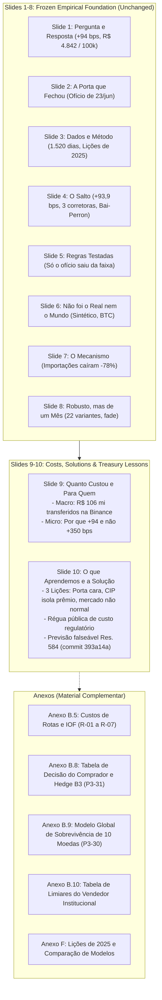

# From Retrospective Shock Analysis to Institutional Treasury Decisions: Comprehensive Assessment of Shock Duration and Holder Decisions

> **Status Note (6 November 2026):** This assessment incorporates all peer-review corrections by Renzo's agent (`0f57637`), accepted by Felipe. All calculations, empirical tables, and narrative claims match exploratory findings [`F-038`](../findings/F-038-shock-duration-feasibility.md) and [`F-039`](../findings/F-039-holder-decisions.md) and the second review in [`docs/shock-duration-holder-review.md`](../docs/shock-duration-holder-review.md) exactly. All prior withdrawn claims (e.g., typed-in premiums, 2.5 bps/day carry cost, break-even $h^*$, "ex-ante optimal" waiting, hazard model beating the base rate, and the "Brazil 20-day spike" link) have been fully purged.
>
> **Check of this rewrite (Renzo's agent, 7 Nov 2026):** price levels in Tables 4.1–4.3 were taken from 17 Jun 2024 (PTAX 5.4124) and are now regenerated from the P3-31 tables (25 Jun 2026: USDT R\$ 5.2785, PTAX 5.1892); Slide 10 options and §§1, 2, 4.4, 5.1, 9 corrected where they went beyond F-024/F-026/F-029/F-031/F-035–F-038; links made relative. Details in `tasks/P3-33-pivot-assessment.md` (log, 7 Nov).

**Author / Working Role:** Felipe (Research Engineer and Critical Reviewer; updated following peer review)  
**Date:** 6–7 November 2026, Brasília time  
**Context:** 7º Datathon de Moedas Digitais FGV EESP (Team Out of Sample)  
**Task Reference:** `tasks/P3-33-pivot-assessment.md` (synthesizing `P3-30`, `P3-31`, `P3-32`)  
**Input Documents:** `findings/F-038-shock-duration-feasibility.md`, `findings/F-039-holder-decisions.md`, `docs/shock-duration-holder-review.md`, `docs/proposal-2026-11-05-lessons-and-solution.md`, `results/tables/P3-30_model_eval.csv`, `results/tables/P3-30_brier_bootstrap.csv`, `results/tables/P3-31_buyer_hedged_comparison.csv`  
**Status:** Completed deliverable; fully updated to incorporate peer-review corrections; ready for independent teammate re-run.

---

## Table of Contents

1. [Executive Recommendation and the Mentor-Driven Objective Change](#1-executive-recommendation-and-the-mentor-driven-objective-change)
2. [Evidence Inventory and Claim Hierarchy](#2-evidence-inventory-and-claim-hierarchy)
3. [Systematic Assessment of Directions in the Original Brief](#3-systematic-assessment-of-directions-in-the-original-brief)
4. [Two-Sided Institutional Treasury Decision Framework (`P3-31` / `F-039`)](#4-two-sided-institutional-treasury-decision-framework-p3-31--f-039)
5. [Global 10-Currency Duration and Survival Model (`P3-30` / `F-038`)](#5-global-10-currency-duration-and-survival-model-p3-30--f-038)
6. [Independent Review and Verification Record (`P3-32` / `docs/shock-duration-holder-review.md`)](#6-independent-review-and-verification-record-p3-32--docsshock-duration-holder-reviewmd)
7. [Two-Day Execution Record, Reproducible Commands, and Open Blockers](#7-two-day-execution-record-reproducible-commands-and-open-blockers)
8. [Portuguese Conclusion Alternatives for Slide 10 (`P5-08`)](#8-portuguese-conclusion-alternatives-for-slide-10-p5-08)
9. [Proposed 10-Slide Deck Narrative and Annex Allocation](#9-proposed-10-slide-deck-narrative-and-annex-allocation)

---

## 1. Executive Recommendation and the Mentor-Driven Objective Change

### 1.1 The Mentor Challenge: Bridging Econometrics and Action

Through phases P1 to P4 of the Datathon, the team successfully established the core econometric facts surrounding the 23 June 2026 Banco Central do Brasil (BCB) supervisory notice (*ofício*):
- An acute, unprecedented spike of **+93.9 bps** ($+73.7$ to $+128.3$ bps across 22 specifications) in the USDT/BRL premium over official PTAX ([`F-016`](../findings/F-016-event-studies-placebos.md), [`F-022`](../findings/F-022-robustness-battery.md));
- A blind structural break detected at 24 June 2026 across all three major Brazilian venues ([`F-011`](../findings/F-011-blind-breaks.md), [`F-009`](../findings/F-009-jump-not-venue-fx-usdt.md));
- A synthetic control treatment gap of **+109.3 bps** separating Brazil from international comparison currencies ([`F-017`](../findings/F-017-synthetic-control.md));
- A **$-78\%$ contraction** in resident stablecoin purchases abroad in official balance of payments statistics ([`F-024`](../findings/F-024-stablecoin-imports.md)); and
- An aggregate private wealth transfer of **R\$ 106.1 million** on Binance alone (**R\$ 145.3 million** across three venues) paid by crypto-dollar buyers over four weeks ([`F-025`](../findings/F-025-money-moved.md)).

The mentor session on 4 November 2026 with David Wasserman (FGV / ex-QR Asset) raised an essential question: *“How does this economic finding guide corporate treasurers, fintech operators, importers, or portfolio managers operating in digital dollars in Brazil?”*

To answer this, our research analyzed the market mechanics facing institutional participants on both sides of the digital-dollar market, coupled with an empirical audit of shock duration predictability.

### 1.2 The Economic Intuition: Transaction Directionality and Covered Interest Parity

A naive market intuition suggests that during a market dislocation, participants should simply "wait for conditions to normalize." In the Brazilian digital-dollar market, this intuition overlooks transaction directionality, interest carry, and hedge mechanics:

1. **Side 1 — The Institutional Buyer (`BRL -> USDT`, Importers / Outbound Remitters / Crypto Funds):**  
   They were among the buyers who paid the **R\$ 106 to 145 million** identified in [`F-025`](../findings/F-025-money-moved.md) (that finding does not identify which kinds of buyers paid it). When buying during an acute spike, they absorb an artificial local markup. If a buyer needs to acquire USDT by an upcoming deadline, waiting in reais avoids paying the elevated premium.  
   However, waiting unhedged exposes the buyer to macro USD/BRL currency depreciation. To eliminate official exchange rate risk, an institutional entity can execute a **B3-Hedged Waiting Strategy**: keep cash in reais in a domestic deposit earning $A_{\text{BRL}} = (1 + r_{\text{BRL}})^{h/252}$, and buy dollars forward at $F = X_t \cdot A_{\text{BRL}} / A_{\text{USD}}$ on B3 (via mini-dollar `WDO` or OTC NDFs).  
   **Under Covered Interest Parity (CIP), the BRL deposit interest exactly pays the forward points: the hedge has zero daily carry cost.**  
   The hedged saving decomposes into three terms:
   $$\text{Hedged Saving} = \text{Premium Compression} + \text{USD Interest Forgone by Holding Idle USDT} - \text{Hedge Fee}$$
   Consequently, when an institutional buyer hedges the official dollar on B3, **the decision to wait no longer depends on exchange rates or domestic interest rates: it is a pure bet on the USDT premium alone.**  
   Retrospectively, waiting from 25 June 2026 (the first PTAX day post-spike, premium 184.35 bps) delivered realized hedged savings of **+89.7 bps (R\$ 4,746)** at 5 days, **+92.3 bps (R\$ 4,896)** at 10 days, and **+164.0 bps (R\$ 8,733)** at 20 days per 100k USDT. However, this gain was neither steady nor predictable: on 3 July (6 days), the premium rebounded to 185.9 bps, leaving waiting with a gain of only **+6.3 bps**.

2. **Side 2 — The Institutional Seller (`USDT -> BRL`, Domestic Obligation Funding):**  
   Conversely, an institution holding USDT that needs to fund domestic BRL liabilities (taxes, payroll, suppliers) suffers a **double penalty** by delaying conversion:
   - *Loss of the Elevated Premium (Premium Decay):* The holder forfeits the temporary local markup over PTAX.
   - *Negative BRL Carry:* Idle USDT earns 0% in BRL, forfeiting 10%–15% annual risk-free BRL interest.  
   To break even against immediate sale, gross USDT/BRL must appreciate by **+18.9 bps (5d), +37.9 bps (10d), and +75.9 bps (20d)** at 10% a.a. net BRL yield. Retrospectively in June 2026, waiting cost the seller **-R\$ 4,697 (5d), -R\$ 11,594 (10d), and -R\$ 21,704 (20d)** per 100k USDT (-R\$ 5,408 / -R\$ 6,167 / -R\$ 11,172 with fixed FX).

3. **Buyer-Seller Duality:**  
   At mid-prices ($c = 0$), the unhedged buyer's savings from waiting is the exact mathematical mirror of the seller's waiting loss: $\Delta \text{BRL}_{\text{unhedged}}^{\text{buyer}} = -\Delta \text{BRL}_{\text{seller}}$.

### 1.3 Duration Modeling and Predictability Reality

To establish whether treasurers or regulators could anticipate how long such premium spikes last, we audited shock duration modeling:
- Single-country Brazilian data fails operational feasibility floors (only 1 test episode in 2026, censored at 111 PTAX days).
- Pooling **10 global currencies** on native trading calendars (10,875 trading days) passes the feasibility floor fixed before fitting (the pool itself was added after Brazil alone failed that floor) ($k=3$: **43/38 train, 10/8 val, 8/6 test**).
- Non-parametric Kaplan-Meier estimation shows that in the 2020–2024 training pool, **7.1%** of shocks recovered within 5 business days, **26.7%** within 10 days, and **51.1%** within 20 days (median = **20 business days**).
- However, a regularized discrete-time hazard model ($\lambda = 10$, selected on 2025 validation) **does not reliably beat the Kaplan-Meier base rate**: it loses on 2025 validation (0.346 vs 0.330), loses at $k=2$ (0.239 vs 0.205) and $k=4$ (0.042 vs 0.037), loses on pooled ongoing ages 0/5/10 (0.255 vs 0.222), and its slight 2026 test gain (0.175 vs 0.188) has a 95% bootstrap confidence interval of **$[-0.112, +0.073]$**, which cleanly spans zero.
- Under the $3\sigma$ rule, Brazil's 2026 episode started on **25 May 2026** and remained unrecovered after **111 PTAX days** on 30 October 2026.

**Conclusion:** How long a premium shock lasts cannot be forecast better than the historical base rate ("half recover within about 20 business days"). Treasuries and regulators should plan using historical base rates and scenario bounds rather than trusting point forecasts.

---

## 2. Evidence Inventory and Claim Hierarchy

Every metric, model, and claim in this deliverable is cataloged across four operational tiers:

```
+----------------------------------------------------------------------------------------------------+
|                                    RESEARCH EVIDENCE HIERARCHY                                      |
+----------------------------------------------------------------------------------------------------+
|  TIER 1: FINDINGS F-001 to F-033 (frozen; F-012, F-029 to F-033 exploratory)                       |
|  - Tagged `results-frozen` on 4 Nov 2026. Immutable empirical baseline.                             |
|  - F-001/F-016: Real premium & +93.9 bps jump after the 23 Jun 2026 notice.                        |
|  - F-007/F-009: 2-10 bps noise floor; identical jump across Binance, Foxbit, Mercado Bitcoin.       |
|  - F-011/F-016: Blind Bai-Perron break; p ≈ 0.001 vs 1,073 clean placebos.                         |
|  - F-015/F-025: R$ 4,842 / US$ 100k acute cost; R$ 106.1 mn transfer on Binance.                   |
|  - F-022/F-024: Post-22 Jul fade indistinguishable from drift (p=0.24); imports fell -78%.         |
|  - F-026/F-027: Only confidential notice moved premium; Res. 584 prediction committed.             |
|  - F-031/F-032 (exploratory): seller-initiated Foxbit flow ~362 mn USDT in the fade; seller unknown.|
+----------------------------------------------------------------------------------------------------+
                                                 |
                                                 v
+----------------------------------------------------------------------------------------------------+
|  TIER 2: EXPLORATORY FINDINGS (F-034 to F-037)                                                      |
|  - Post-freeze investigations subject to explicit caveats.                                         |
|  - F-034/F-037: Pix->BRLA->USDC route rose +111 bps after the notice (USDT +94).                   |
|  - F-035: E1 readout +2.1 bps (p=0.90); re-run and P3-26 audit pending.                            |
|  - F-036: Foxbit volume share surged from 6.8% to 34.7% during recovery and persisted.             |
+----------------------------------------------------------------------------------------------------+
                                                 |
                                                 v
+----------------------------------------------------------------------------------------------------+
|  TIER 3: NEW DURATION AUDIT & RETROSPECTIVE TREASURY CALCULATIONS (F-038 & F-039)                  |
|  - P3-30 / F-038 (Exploratory): Global 10-currency survival modeling (10,875 trading days).         |
|    Passes feasibility gate (43/38 train, 10/8 val, 8/6 test). KM median = 20 business days.        |
|    Hazard model does not beat base rate: Val 0.346 vs 0.330; Test CI [-0.112, +0.073].             |
|    Brazil 2026 shock began 25 May, open after 111 PTAX days. Base rate, not point forecast.        |
|  - P3-31 / F-039 (Exploratory, Retrospective): Two-sided institutional treasury framework.         |
|    Side 1 Buyer: CIP hedge has no daily carry cost; hedged wait +89.7 / +92.3 / +164.0 bps at      |
|    5 / 10 / 20 days (+R$ 4.7k / 4.9k / 8.7k); not steady (+6.3 bps on 3 Jul).                      |
|    Side 2 Seller: Hurdle +18.9 / +37.9 / +75.9 bps; June waiting loss of -R$ 4.7k / 11.6k / 21.7k. |
|    Duality symmetry: Buyer unhedged savings = - Seller waiting loss at mid-prices.                  |
+----------------------------------------------------------------------------------------------------+
                                                 |
                                                 v
+----------------------------------------------------------------------------------------------------+
|  TIER 4: SCENARIO & FRICTION PARAMETERS (R-01 to R-07, B3 Exchange Schedules)                      |
|  - R-01: BCB EE 48/2019 commercial bank corporate FX spread: 20 bps baseline.                     |
|  - R-02: Statutory IOF rates (Decreto 6.306/2007: 0% funds art. 15-B III; 1.1%; 3.5%).            |
|  - R-05/R-06: Foxbit & Mercado Bitcoin maker/taker execution schedules.                             |
|  - R-07: CIP forward carry / WDO contract: SOFR 5.0%, hedge fee 0.22 bps one-off.                  |
|  - Rate Scenarios: r_BRL in {0%, 5%, 10%, 15%, 20%} net annual; r_USD in {0%, 4%} organic DeFi.    |
+----------------------------------------------------------------------------------------------------+
```

### Table 2.1: Master Evidence Inventory

| Category | Identifier | Description / Exact Value | Status in Repository | Function in Assessment |
|---|---|---|---|---|
| **Frozen Core** | [`F-001`](../findings/F-001-premium-above-noise.md) | USDT/BRL premium is real (0.2–1.0%), exceeding noise | Frozen (`results-frozen`) | Baseline price phenomenon |
| **Frozen Core** | [`F-007`](../findings/F-007-noise-floor.md) | Bid-ask trading friction floor is 2–10 bps | Frozen (`results-frozen`) | Floor for economic significance |
| **Frozen Core** | [`F-009`](../findings/F-009-jump-not-venue-fx-usdt.md) | Jump identical across Binance, Foxbit, MB; not USD/USDT | Frozen (`results-frozen`) | Cross-venue market validity |
| **Frozen Core** | [`F-011`](../findings/F-011-blind-breaks.md) | Blind Bai-Perron break on 24 Jun 2026 (+100 bps) | Frozen (`results-frozen`) | Unsupervised timing verification |
| **Frozen Core** | [`F-015`](../findings/F-015-route-costs.md) | Acute cost: R\$ 4,842 per US\$ 100k (+93.9 bps at daily PTAX) | Frozen (`results-frozen`) | Dollar-cost unit anchor |
| **Frozen Core** | [`F-016`](../findings/F-016-event-studies-placebos.md) | 23 Jun notice moved premium (+93.9 bps, $p \approx 0.001$) | Frozen (`results-frozen`) | Causal event study benchmark |
| **Frozen Core** | [`F-017`](../findings/F-017-synthetic-control.md) | Synthetic control treatment gap: +109.3 bps (rank 1/6) | Frozen (`results-frozen`) | International counterfactual |
| **Frozen Core** | [`F-022`](../findings/F-022-robustness-battery.md) | Post-22 Jul level (+11 to +19 bps) has placebo $p = 0.24$ | Frozen (`results-frozen`) | Limitation of spike duration |
| **Frozen Core** | [`F-025`](../findings/F-025-money-moved.md) | Buyers paid R\$ 106.1 mn extra on Binance (R\$ 145.3 mn total) | Frozen (`results-frozen`) | Size of the transfer (recipients inferred) |
| **Frozen Core** | [`F-026`](../findings/F-026-which-rules-matter.md) | Only confidential notice moved premium outside $[-35, +38]$ bps | Frozen (`results-frozen`) | Regulatory notice format finding |
| **Frozen Core** | [`F-031`](../findings/F-031-who-traded-the-fade.md) | Seller-initiated Foxbit trading exceeded buyer-initiated by ~362 mn USDT in the fade; seller unknown | Exploratory | Who traded the fade (not identified) |
| **Exploratory** | [`F-035`](../findings/F-035-e1-res574-readout.md) | Registered prediction E1 held (+2.1 bps move, $p = 0.90$) | Exploratory | Registered prediction; teammate re-run and P3-26 confounder audit pending |
| **Exploratory** | [`F-036`](../findings/F-036-recovery-composition.md) | Foxbit market share rose from 6.8% to 34.7% post-shock | Exploratory | Market microstructure adaptation |
| **Exploratory** | [`F-037`](../findings/F-037-brla-route.md) | Polygon Pix $\to$ BRLA $\to$ USDC route rose +111 bps | Exploratory | On-chain rail transmission |
| **New Model** | [`F-038`](../findings/F-038-shock-duration-feasibility.md) | Global 10-currency pool: 20d KM median; hazard model does not beat base rate | Exploratory (`P3-30`) | Empirical duration base rate |
| **New Engine** | [`F-039`](../findings/F-039-holder-decisions.md) | Retrospective two-sided framework: CIP hedged wait +90/+92/+164 bps | Exploratory (`P3-31`) | Retrospective treasury mechanics |

---

## 3. Systematic Assessment of Directions in the Original Brief

In `docs/shock-duration-and-holder-decisions-research-brief.md`, six exploratory research directions were outlined. Below is their technical evaluation:

### Table 3.1: Evaluation of the Six Candidate Research Directions

| Direction | Feasibility & Data Constraints | Econometric & Methodological Risk | Disposition in Project |
|---|---|---|---|
| **1. Fair "Brazil Risk" Benchmark Premium** | PTAX, CDS, and DI swaps available, but no clean risk-neutral shadow price exists. | Crypto liquidity segmentation prevents extracting an asset-pricing benchmark; rolling mean $\ne$ "fair". | Documented as future work; not selected. |
| **2. Transmission Across Markets & Venues** | Multi-venue order books and DEX pools fully available. | Triangular arbitrage enforces tight correlation; cannot isolate regulatory risk from market noise. | Addressed in frozen core ([`F-009`](../findings/F-009-jump-not-venue-fx-usdt.md), [`F-018`](../findings/F-018-btc-heterogeneity.md), [`F-037`](../findings/F-037-brla-route.md)). Complete. |
| **3. Institutional Holder Decision Framework** | PTAX, Binance execution prices, and B3 forward rates fully verifiable. | Past entry prices are sunk costs; must distinguish retrospective outcomes from ex-ante rules. | **Adopted as Two-Sided Treasury Framework (`P3-31` / `F-039`).** |
| **4. SOFR & On-Chain Yield Optimization** | SOFR and Aave/Compound archives available. | [`F-020`](../findings/F-020-subsidy-share-2025.md) showed 37–54% of DeFi yield was subsidies. BRL carry dominates USD yield. | Retained only as organic 4% USD sensitivity in `P3-31`. |
| **5. Statistical Modeling of Shock Duration** | Single-country BRL fails feasibility (1 test episode). 10-currency pool yields 10,875 trading days. | Pooling assumes common recovery mechanism; model does not beat historical base rate out-of-sample. | **Adopted as Global Duration Feasibility & Base-Rate Audit (`P3-30` / `F-038`).** |
| **6. Global Dollar Depegs & On-Chain Shocks** | 11 dollar depegs cataloged ([`F-013`](../findings/F-013-depeg-count-v2.md), [`F-019`](../findings/F-019-depeg-chapter.md)). | Issuer credit/solvency risk is structurally distinct from sovereign FX capital frictions. | Excluded from pooling; preserved as qualitative analogy. |

---

## 4. Two-Sided Institutional Treasury Decision Framework (`P3-31` / `F-039`)

### 4.1 Price Multiplicative Identity and Parameters

Let $Q$ denote the transaction volume in USDT ($Q = 100{,}000$ USDT). At business day $\tau$, the gross spot conversion price is:
$$P_\tau = X_\tau \cdot U_\tau \cdot \left(1 + \frac{p_\tau}{10{,}000}\right)$$
where $X_\tau$ is the official PTAX ask rate (BRL per USD), $U_\tau$ is the global USDT/USD price, and $p_\tau$ is the local premium in basis points.

Proportional transaction frictions $c_\tau$ represent maker/taker exchange fees (10 bps baseline); fixed fees $F_\tau$ represent wire/settlement charges. The domestic risk-free rate is $r_{\text{BRL}}$ (10% effective annual net return scenario); organic USD yield is $r_{\text{USD}}$ (0% baseline, 4% sensitivity per [`F-020`](../findings/F-020-subsidy-share-2025.md)). Time horizon $h = T - t$ is measured in Brazilian PTAX business days (252-day convention).

---

### 4.2 Side 1 — The Institutional Buyer (`BRL -> USDT`, Importers / Outbound Remitters)

Consider a corporate entity required to deliver $Q$ USDT by deadline $T$.

#### Strategy B1: Immediate Acquisition ("Buy Now")
The buyer converts at day $t$ at spot price $P_t$:
$$C_t^{\text{now}}(Q) = Q \cdot P_t \cdot (1 + c_t) + F_t$$
If the acquired USDT earns organic USD yield $r_{\text{USD\_held}}$, the buyer only needs to acquire $Q / A_{\text{USD}}$ at day $t$, where $A_{\text{USD}} = (1 + r_{\text{USD\_held}})^{h/252}$. Accumulated opportunity cost in $T$-reais at domestic rate $A_{\text{BRL}} = (1 + r_{\text{BRL}})^{h/252}$:
$$B_1 = C_t^{\text{now}}\left(\frac{Q}{A_{\text{USD}}}\right) \cdot A_{\text{BRL}}$$

#### Strategy B2: Delayed Acquisition Unhedged ("Wait in BRL")
The buyer retains cash in BRL earning $A_{\text{BRL}}$ and converts at deadline $T$:
$$B_2 = C_T^{\text{wait}}(Q) = Q \cdot P_T \cdot (1 + c_T) + F_T$$
Terminal savings: $\Delta \text{BRL}_{\text{unhedged}}^{\text{buyer}} = B_1 - B_2$.

#### Strategy B3: Delayed Acquisition with B3 FX Hedge (Exact CIP Accounting)
To eliminate official exchange rate risk ($X_T$) while waiting for the premium to normalize:
1. The buyer keeps reais in a domestic deposit earning $A_{\text{BRL}} = (1 + r_{\text{BRL}})^{h/252}$.
2. The buyer buys dollars forward on B3 (mini-dollar `WDO` or OTC NDFs) at the forward exchange rate $F$.
3. Under Covered Interest Parity (CIP):
   $$F = X_t \cdot \frac{A_{\text{BRL}}}{A_{\text{USD\_FWD}}}$$
   where $A_{\text{USD\_FWD}} = (1 + r_{\text{USD\_FWD}})^{h/252}$ ($r_{\text{USD\_FWD}} = 5.0\%$, SOFR per `R-07`).
4. The hedge notional is the planned dollar outlay: $N = Q \cdot U_t \cdot (1 + p_t / 10{,}000) \cdot (1 + c)$.
5. At deadline $T$, the forward contract settles against official PTAX ($X_T$), yielding a derivative cash flow of $N \cdot (X_T - F)$.
6. The buyer pays a one-off hedge fee of 0.22 bps ($N \cdot X_t \cdot \text{fee}$).
7. Total terminal BRL outlay for Strategy B3:
   $$B_3 = C_T^{\text{wait}}(Q) - N \cdot (X_T - F) + N \cdot X_t \cdot \text{fee}_{\text{hedge}}$$

#### Exact CIP Algebraic Decomposition
When $r_{\text{USD\_held}} = 0$, the hedged savings $B_1 - B_3$ decomposes into three terms (verified via unit test `test_b3_hedge_decomposition` in `scripts/p3_31_holder.py`):
$$B_1 - B_3 = \underbrace{Q (1+c) X_T \left[U_t \left(1 + \frac{p_t}{10{,}000}\right) - U_T \left(1 + \frac{p_T}{10{,}000}\right)\right]}_{\text{Premium and USDT/USD Change}} + \underbrace{N X_t A_{\text{BRL}} \left(1 - \frac{1}{A_{\text{USD\_FWD}}}\right)}_{\text{USD Interest Forgone by Holding Idle USDT}} - \underbrace{N X_t \cdot \text{fee}_{\text{hedge}}}_{\text{One-Off Hedge Fee (0.22 bps)}}$$

> [!IMPORTANT]
> **Key Economic Takeaway of CIP Hedge Accounting:**  
> The domestic BRL deposit interest factor $A_{\text{BRL}}$ exactly pays the forward points in $F = X_t A_{\text{BRL}} / A_{\text{USD\_FWD}}$. **The hedge has no daily carry cost.**  
> When an institutional buyer hedges the official dollar on B3, **the decision to wait does not depend on exchange rates or domestic interest rates: it is purely a bet on the USDT premium alone.**

---

### Table 4.1: Retrospective Realized Hedged Buyer Outcomes (`P3-31_buyer_hedged_comparison.csv`)

Evaluated on $Q = 100{,}000$ USDT starting from 25 June 2026 (first PTAX day post-spike; $p_0 = 184.35$ bps, $P_0 = 5.2785$ R\$/USDT, PTAX $X_0 = 5.1892$):

| Horizon ($h$) | Deadline Date | Final Premium ($p_T$, bps) | Premium Change ($\Delta p$, bps) | PTAX Change (%) | Hedged Savings (bps) | Hedged Savings (R\$) | Split: Premium Part (R\$) | Split: USD Carry (R\$) | Split: Fee (R\$) | Hedged Savings (5 bps fee, R\$) | Hedged Savings (USDT 4%, R\$) | Unhedged Buyer Savings (R\$) | Currency Effect (Unhedged - Hedged, R\$) |
|:---:|:---:|:---:|:---:|:---:|:---:|:---:|:---:|:---:|:---:|:---:|:---:|:---:|:---:|
| 1 day | 26 Jun 2026 | 75.62 | +108.72 | -0.380% | +107.36 | +R\$ 5,675 | +R\$ 5,584 | +R\$ 102 | -R\$ 12 | +R\$ 5,422 | +R\$ 5,593 | +R\$ 7,790 | +R\$ 2,115 |
| 5 days | 02 Jul 2026 | 99.19 | +85.16 | +0.102% | **+89.66** | **+R\$ 4,746** | +R\$ 4,246 | +R\$ 512 | -R\$ 12 | +R\$ 4,494 | +R\$ 4,335 | +R\$ 4,706 | -R\$ 40 |
| **6 days** | **03 Jul 2026** | **185.87** | **-1.52** | **-0.337%** | **+6.33** | **+R\$ 335** | **-R\$ 268** | **+R\$ 615** | **-R\$ 12** | **+R\$ 83** | **-R\$ 159** | **+R\$ 2,714** | **+R\$ 2,379** |
| 10 days | 09 Jul 2026 | 103.83 | +80.52 | -1.085% | **+92.32** | **+R\$ 4,896** | +R\$ 3,882 | +R\$ 1,026 | -R\$ 12 | +R\$ 4,644 | +R\$ 4,071 | +R\$ 11,617 | +R\$ 6,721 |
| 15 days | 16 Jul 2026 | 57.67 | +126.68 | -1.767% | +145.15 | +R\$ 7,713 | +R\$ 6,183 | +R\$ 1,541 | -R\$ 12 | +R\$ 7,460 | +R\$ 6,474 | +R\$ 18,527 | +R\$ 10,814 |
| 20 days | 23 Jul 2026 | 45.92 | +138.43 | -2.091% | **+164.04** | **+R\$ 8,733** | **+R\$ 6,688** | **+R\$ 2,058** | **-R\$ 12** | **+R\$ 8,481** | **+R\$ 7,079** | **+R\$ 21,747** | **+R\$ 13,014** |

*Source:* [`results/tables/P3-31_buyer_hedged_comparison.csv`](../results/tables/P3-31_buyer_hedged_comparison.csv).

#### Detailed Findings on Buyer Outcomes:
1. **Retrospective Realized Savings:** A buyer who delayed conversion from 25 June with a B3 hedge saved **+89.7 bps (R\$ 4,746)** at 5 days, **+92.3 bps (R\$ 4,896)** at 10 days, and **+164.0 bps (R\$ 8,733)** at 20 days per 100k USDT. At 20 days, R\$ 6,688 came from premium compression and USDT/USD peg normalization, and R\$ 2,058 from the forward discount (USD interest).
2. **Gain Was Not Steady:** On 3 July (6 business days), the premium rebounded to 185.9 bps. At that point, waiting with a hedge had gained only **+6.3 bps (+R\$ 335)**.
3. **The Unhedged Currency Effect:** At 20 days, the unhedged buyer saved R\$ 21,747. However, **R\$ 13,014 of that saving came from the real appreciating 2.09% on official PTAX** ("currency luck"). The hedged buyer locks official exchange rate risk and captures R\$ 8,733: R\$ 6,688 from the premium and USDT/USD change and R\$ 2,058 from USD interest.

---

### 4.3 Side 2 — The Institutional Seller (`USDT -> BRL`, Domestic Obligation Funding)

For an entity holding $Q = 100{,}000$ idle USDT needing to fund domestic BRL liabilities due at $T$, net proceeds from immediate conversion at $t$ are:
$$N_t^{\text{seller}}(Q) = Q \cdot P_t \cdot (1 - c_t) - F_t$$
Investing these proceeds in domestic BRL instruments yields terminal cash:
$$V_t^{\text{sell}} = N_t^{\text{seller}}(Q) \cdot (1 + r_{\text{BRL}})^{\frac{h}{252}}$$
Delayed conversion at $T$ yields net proceeds:
$$V_T^{\text{wait}} = Q \cdot P_T \cdot (1 - c_T) - F_T$$
The break-even future gross price equating $V_T^{\text{wait}} = V_t^{\text{sell}}$ is:
$$P_T^* = \frac{N_t^{\text{seller}}(Q) \cdot (1 + r_{\text{BRL}})^{h/252} + F_T}{Q \cdot (1 - c_T)}$$
Under symmetric proportional fees ($c_t = c_T = c$, $F=0$), the **Neutral Fee Invariance** holds:
$$\Delta P^* = \frac{P_T^*}{P_t} - 1 = (1 + r_{\text{BRL}})^{\frac{h}{252}} - 1$$

---

### Table 4.2: Seller Break-Even Hurdle Thresholds (`P3-31_thresholds.csv`)

| Horizon ($h$, PTAX days) | Net Annual Rate ($r_{\text{BRL}}$) | Required Gross Price ($P_T^*$, R\$) | Required Gross Appreciation ($\Delta P^*$, bps) | Accumulated "Sell Now" BRL ($V_t^{\text{sell}}$) |
|---|---|---|---|---|
| **5 days** | 0.0% (Zero carry) | 5.278475 | 0.0 bps | R\$ 527,319.65 |
| **5 days** | 5.0% effective | 5.283587 | +9.7 bps | R\$ 527,830.38 |
| **5 days** | **10.0% effective** | **5.288466** | **+18.9 bps** | **R\$ 528,317.80** |
| **5 days** | 15.0% effective | 5.293133 | +27.8 bps | R\$ 528,783.97 |
| **10 days** | 0.0% (Zero carry) | 5.278475 | 0.0 bps | R\$ 527,319.65 |
| **10 days** | 5.0% effective | 5.288705 | +19.4 bps | R\$ 528,341.59 |
| **10 days** | **10.0% effective** | **5.298477** | **+37.9 bps** | **R\$ 529,317.83** |
| **10 days** | 15.0% effective | 5.307831 | +55.6 bps | R\$ 530,252.35 |
| **20 days** | 0.0% (Zero carry) | 5.278475 | 0.0 bps | R\$ 527,319.65 |
| **20 days** | 5.0% effective | 5.298954 | +38.8 bps | R\$ 529,365.52 |
| **20 days** | **10.0% effective** | **5.318554** | **+75.9 bps** | **R\$ 531,323.58** |
| **20 days** | 15.0% effective | 5.337351 | +111.5 bps | R\$ 533,201.36 |

*Source:* [`results/tables/P3-31_thresholds.csv`](../results/tables/P3-31_thresholds.csv). Symmetric 10 bps execution fees.

---

### Table 4.3: Retrospective Seller Performance in June–July 2026 (`P3-31_historical_comparison.csv`)

| Horizon ($h$) | Maturity Date | Final Spot Price ($P_h$, R\$) | Path Evaluated | Sell Now Accumulated ($V_t^{\text{sell}}$, R\$) | Wait Net Proceeds ($V_T^{\text{wait}}$, R\$) | Difference: Wait Minus Sell Now (R\$) | PTAX Factor | Premium Factor |
|---|---|---|---|---|---|---|---|---|
| **5 days** | 02 Jul 2026 | 5.2415 | Actual Indicative | R\$ 528,317.80 | R\$ 523,620.85 | **-R\$ 4,696.94** | 1.0010 | 0.9916 |
| **5 days** | 02 Jul 2026 | 5.2343 | Fixed FX & USDT | R\$ 528,317.80 | R\$ 522,910.27 | **-R\$ 5,407.53** | 1.0000 | 0.9916 |
| **10 days** | 09 Jul 2026 | 5.1824 | Actual Indicative | R\$ 529,317.83 | R\$ 517,724.26 | **-R\$ 11,593.57** | 0.9892 | 0.9921 |
| **10 days** | 09 Jul 2026 | 5.2367 | Fixed FX & USDT | R\$ 529,317.83 | R\$ 523,150.66 | **-R\$ 6,167.17** | 1.0000 | 0.9921 |
| **20 days** | 23 Jul 2026 | 5.1013 | Actual Indicative | R\$ 531,323.58 | R\$ 509,619.87 | **-R\$ 21,703.71** | 0.9791 | 0.9864 |
| **20 days** | 23 Jul 2026 | 5.2067 | Fixed FX & USDT | R\$ 531,323.58 | R\$ 520,152.05 | **-R\$ 11,171.53** | 1.0000 | 0.9864 |

*Source:* [`results/tables/P3-31_historical_comparison.csv`](../results/tables/P3-31_historical_comparison.csv). Net annual effective rate $r_{\text{BRL}} = 10.0\%$; 100,000 USDT lot.

---

### 4.4 Buyer-Seller Duality Symmetry

At mid-prices ($c = 0$), the buyer's unhedged waiting savings is the exact dual of the seller's waiting loss:
$$\Delta \text{BRL}_{\text{unhedged}}^{\text{buyer}}(t, T) = -\Delta \text{BRL}_{\text{seller}}(t, T)$$
With symmetric 10 bps fees, $\Delta \text{BRL}_{\text{unhedged}}^{\text{buyer}} = \frac{1+c}{1-c} \times (-\Delta \text{BRL}_{\text{seller}})$:
- **5 days:** Buyer unhedged savings = **+R\$ 4,706.35** $\leftrightarrow$ Seller waiting loss = **-R\$ 4,696.94**
- **10 days:** Buyer unhedged savings = **+R\$ 11,616.78** $\leftrightarrow$ Seller waiting loss = **-R\$ 11,593.57**
- **20 days:** Buyer unhedged savings = **+R\$ 21,747.16** $\leftrightarrow$ Seller waiting loss = **-R\$ 21,703.71**

This is an accounting identity (the same prices seen from the two sides), not separate evidence. It matches F-025's reading that what buyers paid above the old premium was received by sellers; F-025 infers the recipients, it does not measure them.

---

## 5. Global 10-Currency Duration and Survival Model (`P3-30` / `F-038`)

### 5.1 Dual-Scope Feasibility Gate Audit

Single-country duration modeling in Brazil alone is constrained by sample size: under the locked 3-standard-deviation onset ($k=3$) and 5-day streak recovery protocol, Brazil experienced 11 training episodes (2020–2024), 3 validation episodes (2025), and only 1 test episode in 2026. This fails the operational feasibility floor ($\ge 5$ test episodes).

However, expanding to the **Global 10-Currency Pool** on native trading calendars (sourcing BRL from P1-02, and EUR, TRY, ZAR, MXN, PLN, IDR, COP, UAH, ARS from P1-05) eliminates cross-country holiday censoring and **passes the feasibility floor fixed before fitting (the pool itself was added after Brazil alone failed that floor)**.

### Table 5.1: Feasibility Gate Audit Across Scopes and Thresholds (`P3-30_feasibility.csv`)

| Scope | Threshold ($k$) | Train (Episodes / Rec.) | Val 2025 (Episodes / Rec.) | Test 2026 (Episodes / Rec.) | Feasibility Verdict |
|---|:---:|:---:|:---:|:---:|:---:|
| **BRL_only** | 3 $\sigma$ (primary) | 11 / 10 (Pass) | 3 / 3 (Fail: $3 < 5$) | 1 / 0 (Fail: $1 < 5$) | **Failed (Single-Country)** |
| **BRL_only** | 2 $\sigma$ (sensitivity) | 13 / 12 (Pass) | 2 / 1 (Fail: $2 < 5$) | 1 / 1 (Fail: $1 < 5$) | Failed (Single-Country) |
| **BRL_only** | 4 $\sigma$ (sensitivity) | 6 / 5 (Fail: $6 < 10$) | 2 / 2 (Fail: $2 < 5$) | 1 / 0 (Fail: $1 < 5$) | Failed (Single-Country) |
| **Global 10 Currencies** | **3 $\sigma$ (primary)** | **43 / 38** (Pass) | **10 / 8** (Pass) | **8 / 6** (Pass) | **PASSED (Global Pool)** |
| **Global 10 Currencies** | **2 $\sigma$ (sensitivity)** | **62 / 55** (Pass) | **17 / 13** (Pass) | **14 / 11** (Pass) | **PASSED (Global Pool)** |
| **Global 10 Currencies** | 4 $\sigma$ (sensitivity) | 33 / 28 (Pass) | 5 / 5 (Pass) | 4 / 3 (Fail: $4 < 5$) | Borderline ($4 < 5$ test) |

*Source:* [`results/tables/P3-30_feasibility.csv`](../results/tables/P3-30_feasibility.csv). Strict chronological re-extraction prevents post-cutoff recoveries from leaking into training or validation labels.

---

### Table 5.2: Global 10-Currency Episode Census (`P3-30_census.csv`)

Total extracted episodes and confirmed recoveries across 10,875 native trading days:

| Currency | Trading Days | $k=2$ (Ep. / Rec.) | $k=3$ (Ep. / Rec.) | $k=4$ (Ep. / Rec.) | Calendar Source / Notes |
|---|:---:|:---:|:---:|:---:|---|
| **BRL** | 1,520 | 16 / 16 | 15 / 14 | 9 / 8 | P1-02 USDT/BRL adjusted premium (PTAX) |
| **EUR** | 1,748 | 21 / 20 | 11 / 10 | 8 / 8 | P1-05 Binance USDT/EUR vs ECB |
| **TRY** | 1,749 | 16 / 15 | 11 / 10 | 12 / 12 | P1-05 Binance USDT/TRY vs CBRT |
| **ZAR** | 1,115 | 8 / 8 | 2 / 2 | 0 / 0 | P1-05 Binance USDT/ZAR vs SARB |
| **MXN** | 655 | 4 / 4 | 3 / 3 | 2 / 2 | P1-05 Bitso USDT/MXN vs Banxico |
| **PLN** | 819 | 14 / 13 | 8 / 8 | 4 / 4 | P1-05 Binance USDT/PLN vs NBP |
| **IDR** | 234 | 4 / 4 | 3 / 3 | 1 / 1 | P1-05 Tokocrypto USDT/IDR vs BI |
| **COP** | 569 | 1 / 0 | 2 / 2 | 1 / 1 | P1-05 Bitso USDT/COP vs BanRep |
| **UAH** | 1,615 | 8 / 7 | 5 / 4 | 4 / 3 | P1-05 Binance USDT/UAH vs NBU |
| **ARS** | 851 | 1 / 0 | 1 / 0 | 1 / 0 | P1-05 Binance USDT/ARS vs BCRA |
| **Total Pool** | **10,875** | **93 / 87** | **61 / 56** | **42 / 39** | **Native calendars (zero holiday censoring)** |

---

### 5.2 Out-of-Sample Evaluation and Base Rate Comparison

A penalized discrete-time logistic hazard model was fitted using features $[1.0, \log(1+\text{age}), \log(1+\text{init\_ex}), \text{sign}(\text{cur\_ex})\log(1+|\text{cur\_ex}|), \text{clip}(\text{cur\_z}, -5, 20)]$. The $L_2$ penalty $\lambda = 10.0$ was selected on the 2025 validation set at $h = 10$ business days.

Brier score measures mean squared probability error (lower is better). In accordance with survival analysis standards, episodes censored before horizon $h$ are excluded from scoring. The table reports the primary comparison alongside paired bootstrap 95% confidence intervals (10,000 draws, seed 0):

### Table 5.3: Model Evaluation and Paired Bootstrap Results (`P3-30_model_eval.csv`, `P3-30_brier_bootstrap.csv`)

| $k$ | Split | Horizon ($h$) | Scored ($n$) | Kaplan-Meier Brier | Hazard Model ($\lambda=10$) | Model − KM Difference | Paired Bootstrap 95% CI | Verdict |
|:---:|---|:---:|:---:|:---:|:---:|:---:|:---:|:---:|
| 3 | Validation 2025 | 10 d (primary) | 9 | 0.330 | 0.346 | +0.016 | [−0.048, +0.080] | **Model Loses** |
| **3** | **Test 2026** | **10 d (primary)** | **8** | **0.188** | **0.175** | **−0.013** | **[−0.112, +0.073]** | **Indistinguishable from Zero** |
| 3 | Test 2026 | 5 d | 8 | 0.112 | 0.087 | −0.025 | [−0.146, +0.051] | CI crosses zero |
| 3 | Test 2026 | 20 d | 7 | 0.249 | 0.254 | +0.005 | [−0.100, +0.106] | CI crosses zero |
| 2 | Test 2026 | 10 d | 14 | 0.205 | 0.239 | +0.034 | [−0.003, +0.072] | **Model Loses** |
| 4 | Test 2026 | 10 d | 4 | 0.037 | 0.042 | +0.005 | [−0.013, +0.016] | **Model Loses** |
| 3 | Test 2026 (ages 0/5/10) | 10 d | 20 | 0.222 | 0.255 | +0.033 | — | **KM Beats Model Mid-Episode** |

*Note on test sample:* The 8 test episodes in 2026 comprise BRL (25 May, open), EUR (17 Sep; 8 Oct, open), ZAR (7 May), MXN (20 Feb), and IDR (23 Mar, 9 Jun, 26 Jun). With 3 episodes from Indonesia, effective independent information is limited.

---

### 5.3 What Survival Modeling Teaches

1. **Historical Base Rate:** In the 2020–2024 global training pool, Kaplan-Meier recovery rates are **7.1% at 5 days**, **26.7% at 10 days**, and **51.1% at 20 days**. The median recovery duration is **20 business days**.
2. **Shock Size Does Not Beat the Base Rate:** The hazard model loses to the naive Kaplan-Meier base rate on 2025 validation (0.346 vs 0.330), loses under alternative thresholds ($k=2$ and $k=4$), and its modest 2026 test difference (−0.013) is statistically indistinguishable from zero (95% CI $[-0.112, +0.073]$).
3. **Brazil 2026 Did Not Revert to Band in 20 Days:** Under the objective extraction rule ($3\sigma$), Brazil's 2026 shock began on **25 May 2026** (a month prior to the 23 June notice) and remained open on 30 October 2026 after **111 PTAX business days**. While the premium receded from its late June peak, it did not re-enter its pre-May band.

---

## 6. Independent Review and Verification Record (`P3-32` / `docs/shock-duration-holder-review.md`)

Task `P3-32` underwent a rigorous two-stage review process recorded in [`docs/shock-duration-holder-review.md`](../docs/shock-duration-holder-review.md):

### 6.1 First Review and Supersession
The initial review was completed on 6 November 2026 within the author's working session. Because internal self-approval violates repository standards (`prompt.md` §7), it was designated exploratory and superseded by an independent second review.

### 6.2 Second Review Findings and Corrections (Renzo's Agent, 6 Nov, `0f57637`)
Renzo's agent re-ran all code on Linux, confirmed numerical reproduction, identified ten substantive issues, and patched the scripts:
1. **Premiums Read from Data:** Replaced typed-in values (`142.02 / 45.73 / 51.30 / 29.02 bps`) with actual P1-02 data (`184.35` on 25 Jun, `99.19` on 2 Jul, `185.87` on 3 Jul, `103.83` on 9 Jul, `45.92` on 23 Jul).
2. **Exact CIP Accounting:** Replaced the uncredited 2.5 bps/day carry cost with exact CIP forward pricing, establishing that BRL interest offsets forward points. Withdrew the break-even horizon $h^*$ and "ex-ante optimal" claim.
3. **Censoring in Scoring Corrected:** Episodes censored before horizon $h$ are no longer scored as failures; Brier scoring is bounded to fully observed episodes.
4. **Bootstrap Table Added:** Added `P3-30_brier_bootstrap.csv` to report paired bootstrap confidence intervals.
5. **Base Rate Framing:** Replaced overclaimed predictive accuracy with honest reporting: the model does not beat the historical base rate.
6. **Brazil Duration Clarification:** Acknowledged that Brazil's 2026 episode began 25 May and was still open after 111 PTAX days.

### 6.3 Author Acceptance
On 6 November 2026, Felipe accepted all peer-review corrections, updated task files `P3-30`, `P3-31`, `P3-32`, and `P3-33`, and completely rewrote this assessment. Findings `F-038` and `F-039` remain exploratory until an independent teammate (Nattan or Jonathan) executes the final re-run.

---

## 7. Two-Day Execution Record, Reproducible Commands, and Open Blockers

### 7.1 Reproducible Execution Commands

All tables, figures, and JSON manifests are fully reproducible:

```powershell
# 1. Run Global Survival Model & 14 Unit Tests (P3-30)
py scripts/p3_30_duration.py --test
py scripts/p3_30_duration.py

# 2. Run Two-Sided Treasury Decision Engine & 13 Boundary Tests (P3-31)
py scripts/p3_31_holder.py --test-only
py scripts/p3_31_holder.py
```

*(On Linux / macOS: replace `py` with `.venv/bin/python`.)*

### 7.2 Generated Output Artifacts

- **Tables (`results/tables/`):**
  - `P3-30_run_summary.json`: Hash manifest, gate status, and model coefficients.
  - `P3-30_feasibility.csv`: Feasibility episode and recovery counts.
  - `P3-30_census.csv`: Episode census across 10 currencies (10,875 trading days).
  - `P3-30_descriptive_km.csv`: Kaplan-Meier conditional recovery rates.
  - `P3-30_model_eval.csv`: Brier score evaluation on 2026 test split.
  - `P3-30_brier_bootstrap.csv`: Paired bootstrap confidence intervals for Model − KM.
  - `P3-31_thresholds.csv`: Seller break-even hurdle prices and appreciation bps.
  - `P3-31_historical_inputs.csv`: 21-day PTAX window inputs (25 Jun to 23 Jul 2026).
  - `P3-31_historical_comparison.csv`: Retrospective seller cash flow tracking.
  - `P3-31_buyer_hedged_comparison.csv`: Retrospective buyer B3-hedged performance table (1–20 days).
  - `P3-31_sensitivity.csv`: Seller sensitivity matrix across FX changes and terminal premia.
  - `P3-31_audit.json`: Data provenance and test validation manifest.
- **Figures (`results/figures/`):**
  - `P3-30_global_survival.png`: (A) Global KM curve with 20d median; (B) Predicted recovery vs initial excess.
  - `P3-31_thresholds.png`: (A) Seller hurdles; (B) Retrospective hedged buyer realized outcome by deadline.
  - `P3-31_historical.png`: (A) Seller waiting loss; (B) Buyer hedged vs unhedged outcomes.

### 7.3 Open Team Blockers
- **Teammate Re-Run:** Independent execution of both scripts by Nattan or Jonathan to sign off `checked_by` on `F-038` and `F-039` and advance `P3-30` and `P3-31` from `review` to `done`.
- **Slide 10 Conclusion Selection (`P5-08`):** Felipe to choose the final Slide 10 text structure from Section 8.

---

## 8. Portuguese Conclusion Alternatives for Slide 10 (`P5-08`)

To support finalizing Slide 10, three Portuguese conclusion options are presented below. Each incorporates the corrected `F-038` / `F-039` findings and connects them with the 3-lesson / public-gauge architecture proposed in [`docs/proposal-2026-11-05-lessons-and-solution.md`](../docs/proposal-2026-11-05-lessons-and-solution.md).

```carousel
### Opção A: Síntese Integrada — Régua Pública + Lições de Tesouraria e Duração (Recomendado)
```markdown
**Slide 10 — O que aprendemos: o custo do dólar digital se decide na porta de entrada**

**Três Lições**
1. **Fechar uma porta de uma vez custa caro e rápido:** O ofício de 23/jun gerou sobrecusto de ~0,94% por um mês (R$ 4.842 por US$ 100 mil; R$ 106 mi transferidos na Binance). Regras publicadas com aviso prévio ficaram na faixa das datas comuns (ressalva: Res. 574, publicada na véspera).
2. **O hedge cambial reduz a exposição ao USD/BRL:** Para quem precisa de USDT e tem acesso à B3, o hedge (termo a paridade coberta) zera o carrego diário: os juros em reais pagam os pontos do termo. A decisão de esperar vira uma aposta pura no prêmio (em retrospecto, esperar economizou R$ 4,7 mil a R$ 8,7 mil em 5 a 20 dias; mas em 6 dias o ganho foi de apenas R$ 335). Neste episódio e sob as taxas e custos assumidos, o vendedor que adiou a conversão perdeu R$ 4,7 mil a R$ 21,7 mil, sobretudo pela queda do prêmio e pela valorização do real.
3. **Preço normal não é mercado normal:** O prêmio cedeu em um mês, mas as importações caíram a um terço e a Foxbit passou de 7% para 35% do volume (exploratório). Na duração, modelos estatísticos não batem a taxa histórica: em 10 moedas, metade dos choques volta em ~20 dias úteis, mas o choque brasileiro de 2026 (iniciado em 25/mai) não havia voltado à faixa anterior após 111 dias úteis.

**A Solução: Uma Régua Pública de Custo Regulatório**
① Monitorar o prêmio diário na PTAX com dados públicos → ② Comparar com datas comuns → ③ Registrar previsão no Git antes da vigência → ④ Avaliar impacto em reais.  
*Em uso:* Res. 574 (leitura preliminar +2,1 pb, dentro da previsão; aguarda reexecução e checagem do incidente da Binance) · Res. 589 (6/nov) · Res. 584 (jan/2027).
```
<!-- slide -->
### Opção B: Foco Econômico — Da Tarifa Privada à Paridade Coberta de Tesouraria
```markdown
**Slide 10 — Da Tarifa Privada às Decisões de Liquidez**

- **O custo:** O fechamento imediato do canal cambial dos fundos funcionou como uma tarifa privada de ~0,95% sem arrecadação: transferiu R$ 106 milhões dos compradores para os vendedores de dólar digital em quatro semanas na Binance (R$ 145 milhões em três corretoras). As regras publicadas com aviso prévio não geraram esse custo.
- **A mecânica financeira de tesouraria:**  
  - *Comprador:* Ao proteger o dólar oficial na B3 via paridade coberta, o custo de carrego é nulo (o rendimento dos reais cobre os pontos a termo). A espera isola o risco cambial e foca no prêmio: em junho de 2026, esperar gerou economia retrospectiva de +90 a +164 pb (R$ 4,7 mil a R$ 8,7 mil por 100 mil USDT) em 5 a 20 dias, embora com volatilidade no caminho (+6 pb em 6 dias).  
  - *Vendedor:* Com obrigações em reais, esperar exige alta do USDT de +19 a +76 pb em 5 a 20 dias só para cobrir os juros em reais (cenário de 10% a.a.); em junho, quem adiou perdeu R$ 4,7 mil a R$ 21,7 mil, sobretudo pela queda do prêmio e pela valorização do real.
- **Limites da previsão:** O censo global em 10 moedas mostra que metade dos choques se resolve em 20 dias úteis, mas modelos preditivos não superam essa taxa base. Decisões de tesouraria devem se basear em disciplina de custos e coberturas cambiais, não em previsões pontuais de duração.
```
<!-- slide -->
### Opção C: Foco Prudencial e Risco Regulatório
```markdown
**Slide 10 — Regulação por Surpresa, Limites à Arbitragem e Gestão de Risco**

- **Forma versus Conteúdo:** Entre oito regras datadas, as publicadas com aviso prévio ficaram dentro da faixa das datas comuns (−35 a +38 pb); só o ofício confidencial e de efeito imediato, que interrompeu a importação de cripto pelos fundos, saiu dela (+94 pb). Ressalva: a Res. 574 (reporte), publicada na véspera, coincide com um dia de +38 pb e fica fora dessa comparação.
- **Gestão de caixa institucional:** Em momentos de estresse regulatório, stablecoins descolam da paridade oficial. A paridade coberta de juros (CIP) na B3 permite que compradores com acesso a derivativos travem o câmbio oficial sem custo líquido de carrego, transformando a espera em aposta exclusiva sobre o prêmio local. Para vendedores, a conversão imediata elimina a perda de carrego em reais.
- **Transparência e falseabilidade:** Auditorias out-of-sample revelam que o tamanho do choque não prevê sua duração melhor que a taxa histórica global (mediana de 20 dias úteis). Uma régua pública, com previsões registradas antes da vigência em código aberto, permite medir o custo de cada regra.
```
````

---

## 9. Proposed 10-Slide Deck Narrative and Annex Allocation



### 9.1 Slide-by-Slide Narrative Mapping

- **Slide 1 — Quanto custa fechar a porta?** (*Unchanged core*)  
  Headline answer: $+93.9$ bps over PTAX, costing R\$ 4,842 per US\$ 100,000 for one month ([`F-015`](../findings/F-015-route-costs.md), [`F-016`](../findings/F-016-event-studies-placebos.md)).
- **Slide 2 — A porta que fechou: o ofício de 23/jun** (*Unchanged core*)  
  The institutional mechanism: investment funds importing crypto via zero-IOF FX contracts. Confidential BCB supervisory notice demanded immediate discontinuation ([`F-023`](../findings/F-023-notice-sources-and-press-moves.md)).
- **Slide 3 — Dados e método** (*Unchanged core*)  
  1,520 business days of PTAX-aligned hourly data; Binance, Foxbit, Mercado Bitcoin; 5 comparison currencies. Transparency declaration: hypotheses committed prior to confirmatory tests. Lessons from 2025: naive baseline alongside every model ([`F-005`](../findings/F-005-2025-model-lost-to-naive.md), [`F-007`](../findings/F-007-noise-floor.md)).
- **Slide 4 — O salto** (*Unchanged core*)  
  $+93.9$ bps jump in the 20 days post-notice. Blind Bai-Perron structural break on 24 June 2026. Exceeds all 1,073 clean placebos; $p = 0.032$ across 30 non-overlapping windows ([`F-011`](../findings/F-011-blind-breaks.md), [`F-016`](../findings/F-016-event-studies-placebos.md), [`F-029`](../findings/F-029-headline-inference.md)).
- **Slide 5 — Entre as oito regras testadas, só o ofício saiu da faixa comum** (*Unchanged core*)  
  Seven published regulatory acts remained within the $[-35, +38]$ bps noise band. Only the confidential notice with immediate effect broke out ([`F-026`](../findings/F-026-which-rules-matter.md)). Caveat: Res. BCB 574 reporting on 22 June.
- **Slide 6 — Não foi o real, nem o USDT, nem o mundo** (*Unchanged core*)  
  Synthetic control reveals a $+109.3$ bps treatment gap (Brazil ranks #1 of 6). PTAX moved $+0.68\%$ (ordinary move, already subtracted). Global USDT/USD peg moved $<1$ bp. BTC/BRL moved in lockstep ([`F-009`](../findings/F-009-jump-not-venue-fx-usdt.md), [`F-017`](../findings/F-017-synthetic-control.md), [`F-018`](../findings/F-018-btc-heterogeneity.md)).
- **Slide 7 — O mecanismo: as importações caíram** (*Unchanged core*)  
  BCB balance of payments statistics: resident stablecoin purchases abroad dropped $-78\%$ in July ($p = 0.02$). Higher price paired with lower quantity is consistent with a contraction of inward supply (not proof of it) ([`F-024`](../findings/F-024-stablecoin-imports.md)).
- **Slide 8 — Robusto, mas de um mês** (*Unchanged core*)  
  Robust across 22 specifications ($+74$ to $+128$ bps). Post-22 July level ($+11.5$ to $+19.3$ bps) has placebo $p = 0.24$; channel reopening unverified; marginal price-setting route unidentified ([`F-022`](../findings/F-022-robustness-battery.md), [`F-028`](../findings/F-028-route-comparison.md), [`F-030`](../findings/F-030-no-verified-reopening.md)).
- **Slide 9 — Quanto custou e para quem: a transferência agregada**  
  Buyers paid R\$ 106.1 million extra on Binance (R\$ 145.3 million across three exchanges). Clarification of the "+350 bps" puzzle: 3.5% IOF is a statutory tax, not an equilibrium price; the market never reached it ([`F-025`](../findings/F-025-money-moved.md), [`F-028`](../findings/F-028-route-comparison.md)).
- **Slide 10 — O que aprendemos com a solução e por que importa**  
  *Synthesis of Lessons and Public Gauge:*
  1. *Lesson 1:* Unannounced closures create immediate, costly price distortions (+94 bps, R\$ 106M transfer).
  2. *Lesson 2:* Access rules set the price. Hedging official dollar risk on B3 under Covered Interest Parity (CIP) carries zero daily cost, making waiting a pure bet on the crypto-dollar premium (retrospectively saving R\$ 4.7k–8.7k in June 2026, but only R\$ 335 at 6 days) ([`F-039`](../findings/F-039-holder-decisions.md)).
  3. *Lesson 3:* Volume and microstructure remain altered after prices recede. Duration models do not beat the historical base rate (half resolve in 20 days; Brazil 2026 shock open >110 days) ([`F-038`](../findings/F-038-shock-duration-feasibility.md)).
  4. *The Solution:* A public, open-source daily regulatory cost gauge with pre-registered predictions (Res. 574: preliminary readout within the prediction, teammate re-run and P3-26 audit pending; Res. 589; Res. 584 committed in commit `393a14a`; [`F-027`](../findings/F-027-prediction-res584.md)).

### 9.2 Annex Allocation

- **Anexo B.8 — O Framework de Decisão do Comprador e Cobertura B3:** Full derivation of CIP hedge mechanics, zero carry cost proof, and realized buyer outcomes table from [`results/tables/P3-31_buyer_hedged_comparison.csv`](../results/tables/P3-31_buyer_hedged_comparison.csv).
- **Anexo B.9 — Modelo Global de Sobrevivência e Censo de 10 Moedas:** Feasibility gate breakdown ([`results/tables/P3-30_feasibility.csv`](../results/tables/P3-30_feasibility.csv)), multi-currency census ([`results/tables/P3-30_census.csv`](../results/tables/P3-30_census.csv)), out-of-sample Brier evaluation and bootstrap table ([`results/tables/P3-30_brier_bootstrap.csv`](../results/tables/P3-30_brier_bootstrap.csv)), and survival curve figure [`results/figures/P3-30_global_survival.png`](../results/figures/P3-30_global_survival.png).
- **Anexo B.10 — Limiares do Vendedor Institucional e Doutrina de Custos Afundados:** Seller break-even hurdle table ([`results/tables/P3-31_thresholds.csv`](../results/tables/P3-31_thresholds.csv)), sensitivity matrix ([`results/tables/P3-31_sensitivity.csv`](../results/tables/P3-31_sensitivity.csv)), and proof of Buyer-Seller Duality Symmetry.
